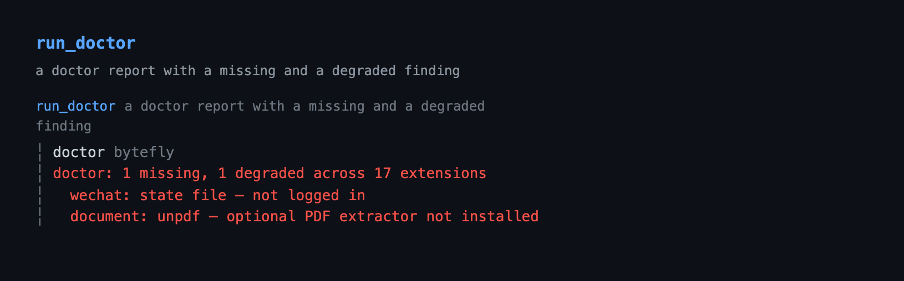

# bytefly — the TUI header, footer, user-message marker, turn rule, extension screen, and notifications

`bytefly` owns the terminal chrome, configuration, and diagnostics surfaces
this package adds: one themed startup header whose two-tone nameplate carries
the agent and chrome identities, one compact, colorful, width-adaptive two-line
footer, a two-row `You` nameplate that opens each user message, a labeled rule that
marks each completed turn in the transcript, one keyboard-driven screen with two
sections — Extensions, every resolved Pi extension with its enable checkbox and
its health, and Settings, the common app and `bytefly.json` preferences — and
an opt-in notify capability that raises an OS notification when a run finishes,
a job finishes, or the agent asks for input, and a published-version check that
marks the header and posts one notice when a newer bytefly is on npm.
DeepSeek is priced from the provider's published yuan rates and peak tariff by
default, and any other model can be priced from your own rates when Pi's catalog
does not match what a provider actually charges.

```
pi --extension ./extensions/bytefly   # load just this extension
pi -e .                               # load the whole @gavin-hu/my-pi-agent package
pi install ./                         # install the package
```

## Tool rendering

How the `run_doctor` call and its result look in the transcript — the call line as a headline and the body indented under it:



## What it does

The extension owns ten surfaces: the startup header, the footer, the
user-message marker, the rule between completed turns, the notice block for
shared transcript notices, the tool-block frame, the live working counter, the
two-section control center, notifications, and the published-version check.

**Header.** A nameplate: a two-tone half-block mark from the active theme's
`accent` / `warn` roles, the agent identity (`Pi`, bold, and its version), the
chrome identity (`enhanced by bytefly` and the package version), a signature
rule whose `accent` lead sits under the mark, and a grouped help block. The help
keys resolve live from Pi's keybindings, so a rebound key shows the user's
chord; the identity and help text are `meta` / `faint` so the mark keeps the
eye. It is installed only in interactive (`tui`) sessions when Pi's
`quietStartup` is `true` — the Settings row **Bytefly startup TUI** — and
`false`, `"header"`, and unset leave Pi's built-in header in place; on terminals
that cannot render half blocks the mark falls back to a two-tone `Pi` wordmark.

```
 █▀█  Pi v1.2.0
 █▀ █ enhanced by bytefly v0.8.1
 ─────────────────────────────────────────────────
   escape to interrupt · ctrl+c to clear · ctrl+d to exit (empty)
   ctrl+o to expand tools · ctrl+t to expand thinking · ctrl+l to select model
   / commands · ! bash · !! bash (no context) · /bytefly extensions
```

As the terminal narrows, the identity sheds the update marker, then the chrome
version, then the chrome line, then the agent name, and the help rows drop whole
keys, so nothing wraps or clips mid-word. The nameplate sits on the transcript margin, which follows Pi's
`outputPad` (the value the tool frame and the notice use too), and the help hangs
one body indent inside it. The mark, tokens, identity, and grouped help are tuned
in [`header/config.ts`](./header/config.ts).

**Footer.** Two lines, each with a left and right zone:

- **Line 1 — identity:** `pwd` and the session name on the left; git state
  (`⎇ branch · ⑂ worktree`) and the `◉` browse chip on the right.
- **Line 2 — resources:** the context gauge and usage meters on the left, the
  mode/alert slot (`⋮ plan`) trailing after a `╎` when present; the model and
  thinking level on the right. The gauge is anchored at column 0, so `%` is
  always in the same place.

```
~/repo/my-pi-agent                                                    ⎇ main · ⑂ smoke
▰▰▰▰▰▰▱▱▱▱ 62%/200k · ¥0.31 · ↑42k ↓8.0k · R96k CH 87% ╎ ⋮ plan    opus-4.5 · high
```

(The examples show the default `¥` symbol. For a model the built-in table does
not cover, the number stays Pi's recorded USD amount — see the currency note
under [Configuration](#configuration).)

With no plan mode there is no mode slot, so the `╎` is omitted:

```
~/repo/my-pi-agent                                                    ⎇ main · ⑂ smoke
▰▰▰▰▰▰▱▱▱▱ 62%/200k · ¥0.31 · ↑42k ↓8.0k · R96k CH 87%             opus-4.5 · high
```

As the terminal narrows, segments shrink and drop by priority rather than
clipping. The branch keeps its name and is dropped when the name no longer
fits, rather than collapsing to a bare glyph:

```
~/repo/project                    ⎇ main · ⑂ smoke
▰▰▰▰▰▰▱▱▱▱ 62% · ¥0.31 ╎ ⋮ plan    opus-4.5 · high
```

```
project   ⎇ main
62% ⋮   opus-4.5
```

With a named session, the name follows the path and truncates before it drops:

```
~/repo/project · feature-refac…   ⎇ main
▰▰▰▰▰▰▱▱▱▱ 62% ╎ ⋮ plan         opus-4.5
```

Zero-value meters are omitted, so a fresh session shows only `?/window` instead
of a row of `¥0.00 · ↑0 ↓0 · R0 W0`. Unknown context usage shows a muted `?`
with no gauge (known `0%` still draws the empty gauge), so unknown and zero stay
distinct. Cost keeps the configured precision — the segment drops rather than
rounding to a misleading `¥0.3` — and a positive amount below one minor unit
shows as `¥<0.01` rather than `¥0.00`.

DeepSeek needs no config file at all: the bar prices it from the published yuan
rates and peak tariff built into [`footer/price/config.ts`](./footer/price/config.ts). A
`bytefly.json` adds models of your own, or replaces a built-in entry:

```
~/repo/project                                                          ⎇ main
▰▰▰▰▰▰▱▱▱▱ 62%/200k · ¥2.50 · ↑42k ↓8.0k · R96k CH 87%             opus-4.5 · high
```

**User message.** Every user message opens with a two-row `You` nameplate —
the label over a rule that spans the width — above the message:

```
You
────────────────────────────────────

the message the user typed
```

It is always on in interactive sessions and has no config file. Pi renders a
user message as Markdown and owns its colors, so bytefly's only lever is a
`registerMarkdownTransformer`: the nameplate is a single level-2 heading whose
text is padded so the rule wraps onto the second row, and both rows carry the
accent because the themes point `mdHeading` at it. The block carries no fill —
the shipped themes set `userMessageBg` to the terminal default, so it reads like
the tool blocks. The nameplate is separated from the message by a blank line, so
the message's own Markdown (a fence, a list, a second paragraph) parses exactly
as it would without it, and a soft wrap of one long line stays at the margin
because the renderer wraps it, not bytefly. The label and the rule are tuned
in [`message/config.ts`](./message/config.ts).

**Working timer.** Pi's working row shows a static `Working`, so a long run
reads the same as a short one. While the row is up, bytefly advances its
message once a second and hands it back to Pi when the row comes down:

```
Working… 12s
```

The count is tied to the row's visibility: it starts on `turn_start`, the event
the host shows the working indicator on, and stops on `agent_end`, where the
host clears it, then again on `session_shutdown`. Turns inside one run do not
restart it — the host keeps the same row up across turns — so the count covers
the whole run, tool calls included. A retry is a new run, so the count restarts
when its row reappears. The word and the interval are tuned in
[`working/config.ts`](./working/config.ts).

**Turn separator.** After each completed turn the extension appends an inert
entry and draws a centered `╌╌╌ turn N ╌╌╌` rule across the transcript; see
[Turn separator](#turn-separator). No config file is needed and there is no
command.

**Notices.** Any extension in the package can post a transcript notice under the
shared `my-pi-agent/notice` type; bytefly draws it at the transcript's margin —
a `source · title` headline at the margin, then rail-led rows, each with its own
severity glyph:

```
job · 2 background jobs finished
╎ ✓ j1 build · exit 0
╎ ✕ j2 test · exit 1
```

The rail is painted by the notice's worst severity, so a failure reads red at the
edge like an errored tool result.

`job` and `watch` post one when a background job finishes or a watched line
matches, so the report the model reads is visible too. `doctor` posts one when a
hard requirement is missing at session start, with a row per finding and the
command that fixes it:

```
doctor · 1 missing prerequisite
╎ ✕ worktree (git) · install git and make sure it is on PATH
```

The type and the `NoticeDetails` shape are the shared contract in
[`lib/notice.ts`](../../lib/notice.ts), and the severity glyphs and item cap
are tuned in [`notice/config.ts`](./notice/config.ts). Every field is sanitized
and clipped at the boundary, and a message without `details` keeps Pi's default
custom-message box.

**Tool blocks.** Every tool block leads with the tool's own call line as the
headline — the tool name in the theme's tool-title colour — and its result body
sits two columns in directly beneath it, led by the transcript rail, instead of
Pi's filled status background:

```
read src/app.ts
╎ const answer = 42;
```

The two tools that mutate a file, `edit` and `write`, carry their result on the
call body — the edit diff, the written file content — so that body is railed
like any other result. There is no status band: the diff's own red/green line
colours, with the changed words in reverse video, and the `edit` / `write`
headline are what mark a file change.

A `registerToolRenderer` resolver switches the row to `renderShell: "self"`,
leaves the call's own first line as the headline, and indents the rest of the
call and the whole result under it. A shell call's `$` / `>` prompt becomes the
tool name and the command is repainted in the body colour, and a primary subject
(a path, URL, query, pattern) is demoted to the body colour too, so the name is
the call line's only accent (`bash bun run check`, `read src/app.ts`). The
tool's own
`renderCall`/`renderResult` are passed through, so syntax highlighting, diffs,
previews, and truncation notices are unchanged — only the frame is bytefly's.
The body carries the transcript rail, painted by status (a running result takes
the accent, a failure red, a finished one neutral) and drawn with the glyph from
the `chrome.rail` setting. A result frame is always railed; a call frame is railed
only for `edit` and `write`, whose call body carries the result — every other
call's headline and continuation lines stay plain-indented. Package renderers
clip a call to one physical line (middle clip for a path or URL), so it cannot
leak into the body column; Pi's own renderers still wrap, and the frame keeps a
wrapped continuation unrailed and loses the accent there too, with the rail
beginning at the result underneath. A rejected call renders as one sanitized
`error` line in the error role; a running tool shows a live elapsed label, and a
finished long call appends its duration. A tool with
no renderer of its own is framed around a generic call/result fallback, whose
call line reads like a built-in — the leading string argument bare, the rest as
trailing options (`open_path src/app.ts`) — rather than dumping raw `key=value`
pairs. A tool that draws its own shell (`edit`) is framed too:
`renderShell: "self"` only tells Pi not to draw its box around the renderer, so
its diff would otherwise sit at the wrong indent; the frame drops the blank
edges its own `Box` pads itself with, and hands it a theme whose `bg` is inert so
it never paints a band the rest of the transcript does not have.

The call line is one colour grammar, shared with Pi's built-ins: the tool name is
`toolTitle` and bold and is the line's only accent; a primary subject (a query, a
URL, a path, a status) reads in the body role (`label`), counts and summaries are
`muted`, trailing options are `dim`, and the result body is `toolOutput`. The
shipped themes point `toolTitle` at the accent and `label` at the body colour, so
the name is the call line's one accent and the subject follows as body text; a
theme that maps `toolTitle` elsewhere is respected rather than overridden.

**Control center.** `/bytefly [extension] [refresh]` opens a keyboard-driven
dock list of every Pi extension the session resolves — across personal settings
and, when trusted, the project — one row per extension with its enable checkbox
and its worst-severity health, and writes a `+pattern` / `-pattern` toggle into
the matching `settings.json`. `←`/`→` switch to Settings, which lists the
preferences this package and Pi expose: bytefly startup TUI, desktop notifications,
the transcript rail glyph, output padding, and the hardware cursor. The focused
extension's findings, or the focused setting's source and target file, sit
underneath, and `run_doctor` returns the same report as text and typed data.
Only a missing
*hard* requirement posts a notice at session start; everything else waits in the
report.
See [The bytefly screen](#the-bytefly-screen).

**Notify.** Off by default, one `notify` section in `bytefly.json` turns on OS
notifications for unattended runs: when a full agent run settles, when a
background job finishes, and when the agent opens a prompt asking for input. The
method follows the terminal (OSC 777, OSC 99, a Windows toast) or falls back to
the platform notifier (`osascript`, `notify-send`); see
[Notifications](#notifications).

**Update check.** Once per interactive session, in the background, the loaded
version is compared with the published `@gavin-hu/my-pi-agent` on npm. A newer
one puts `↑0.12.0` after the header's chrome version and posts one transcript
notice naming `pi update --extensions`. The check is skipped when `PI_OFFLINE`
is set, makes no request outside `tui`, and a failed request is silent; see
[Update check](#update-check).

## Commands

| Command | What it does |
|---|---|
| `/bytefly [extension] [refresh]` | Open the control center on Extensions. In `tui` it mounts a docked list; every other mode prints the grouped listing, or one extension's full findings when named. |
| `/bytefly settings` | Open the control center on Settings. Outside `tui` it prints the grouped settings listing with each row's value. |
| `/bytefly doctor [extension] [refresh]` | Print the doctor report. Outside `tui` it prints `run_doctor`'s text for every extension, or one named extension's findings; in `tui` it mounts the same docked screen. |

Tab completes the subcommands, extension names after `doctor`, and `refresh`;
`/bytefly settings` takes no name.

## Behaviour by mode

The footer and turn rule are installed only in interactive (`tui`) sessions;
the header is too, but only when Pi's `quietStartup` is `true` (the **Bytefly
startup TUI** toggle). `false`, `"header"`, and unset leave Pi's built-in
header in place. Every mode loads the extension, and non-TUI modes change
nothing. The screen is available in every mode: in `tui`, `/bytefly` and
`/bytefly doctor` mount the docked screen, while RPC, JSON, and print modes
print the grouped listing with a per-row health suffix and the headline, or that
extension's full findings when one is named. In `tui` the screen opens on the
session's cached report and probes on the first Extensions view; the text modes
probe before they print. `/bytefly settings` prints the
grouped settings listing with each row's value outside `tui`; it does not
resolve packages or probe the doctor. The
proactive session-start check posts a transcript notice through the shared
`my-pi-agent/notice` renderer rather than a transient notification, and is
skipped when there is no UI or when Pi's `quietStartup` setting is not `true`
(`false`, `"header"`, and unset leave Pi's startup surface in charge, so the
notice is silent). Notify runs in every
mode and picks its method from the environment; the OSC methods need a TTY, so a
print/JSON/RPC run gets an OS-level notification or none.

## Configuration

The header is tuned in [`header/config.ts`](./header/config.ts) — the mark and
identity theme tokens, the tagline, and the grouped help entries (each naming a
Pi keybinding resolved live or a raw command prefix). The footer's
content and layout are tuned in [`footer/config.ts`](./footer/config.ts) —
thresholds, gauge
glyphs and widths, separators, icons, and status keys. The turn separator has no
JSON either: its glyph, label prefix, padding, and colors are tuned in
[`separator/config.ts`](./separator/config.ts).

The transcript rail's glyph is the one chrome value that is JSON-configurable:
the `chrome` section's `rail` key (default `╎`) picks a single-column rail glyph,
read at `session_start`/`session_tree`. Everything else about the chrome is tuned
in code.

Everything JSON-configurable lives in `bytefly.json`, one shared document with a
top-level section per extension (see [Configuration](../../docs/configuration.md)).
It is read from the global document, then `<cwd>/.pi/bytefly.json`. The old
per-extension files
(`document.json`, `jobs.json`, …) are no longer read; run
`bun run config:migrate` to move them into the shared document.

The price
calculation is configured by the `price` section of the shared `bytefly.json`
(see [Configuration](../../docs/configuration.md)), read from
`~/.pi/agent/bytefly.json`, then `<cwd>/.pi/bytefly.json` (project wins).

Both documents are optional, and neither is needed for DeepSeek. The built-in
table is the base layer for every session: DeepSeek is priced in yuan at the
published peak and off-peak rates, and every other model keeps Pi's recorded
cost, whose number comes from Pi's catalog. A document can change the currency,
replace a built-in rate, or add rates of your own. A malformed document is
ignored, a wrong-typed value falls back to its default, and an unknown timezone
drops the schedule rather than the session.

```json
{
  "price": {
    "currency": { "symbol": "¥", "decimals": 2 },
    "fallbackToRecordedCost": true,
    "rates": {
      "deepseek/deepseek-flash":  { "input": 2, "output": 8, "cacheRead": 0.04, "cacheWrite": 0, "offPeakMultiplier": 0.5 },
      "deepseek/deepseek-v4-pro": { "input": 9, "output": 27, "cacheRead": 0.3, "cacheWrite": 0, "offPeakMultiplier": 0.5 }
    },
    "peak": {
      "timezone": "Asia/Shanghai",
      "windows": [
        { "days": [1, 2, 3, 4, 5], "from": "09:00", "to": "12:00" },
        { "days": [1, 2, 3, 4, 5], "from": "14:00", "to": "18:00" }
      ]
    }
  }
}
```

That file restates the built-in defaults, so on its own it changes nothing; it
is shown to document every key at once.

| Key | Meaning |
|---|---|
| `currency.symbol` | Printed before the number; at most four characters. Default `¥`. |
| `currency.decimals` | Digits after the point, 0–4. Default `2`. |
| `fallbackToRecordedCost` | Use Pi's recorded cost for a record no rate matches. Default `true`. |
| `rates` | Per-million-token prices in `currency`, keyed by `provider/model`; the built-in DeepSeek table is the base, and a key stated here replaces its entry. |
| `rates.<key>.input` · `output` · `cacheRead` · `cacheWrite` | Rate per token class; a class left out is free. |
| `rates.<key>.offPeakMultiplier` | Multiplier outside every peak window, 0–1. Default `1`. |
| `peak.timezone` | The IANA zone the windows are stated in. |
| `peak.windows` | `days` (1 = Monday … 7 = Sunday; omitted means every day), `from` inclusive, `to` exclusive, `HH:MM` local; a `to` before `from` wraps midnight. An empty list means every moment is peak. |

Rates merge key by key across the two documents, so a project document can
override one model without restating the rest; a key present in both is replaced,
not merged field by field. No windows means every moment is peak, so a rate with
`offPeakMultiplier: 0.5` and no schedule stays flat. The `price` section is read
once per install — at `session_start`, and again on a `session_tree` change — so
a new session or tree change picks up an edit; there is no toggle, and nothing
watches the file.

**Mixing currencies is the sharp edge of the built-in default.** A record priced
from `rates` or the built-in table is in `currency.symbol` units — yuan for
DeepSeek — while a record that fell back carries Pi's USD number under that same
symbol. A session mixing DeepSeek with another provider therefore sums two
currencies into one number. Either cover every model you use (a `"*"` catch-all
helps) and set `fallbackToRecordedCost: false`, or set the symbol to `"$"` and
treat the rates purely as an off-peak correction.

### The `notify` section

The notify capability reads the same shared `bytefly.json`, under its own
top-level `notify` key.
It is **off by default**; `enabled: true` is the whole setup needed for an
unattended run, and the three trigger flags then narrow what is announced. The
price section and the notify section are parsed independently, so a wrong-typed
value in one never reaches the other.

```json
{
  "notify": {
    "enabled": true,
    "turnFinished": true,
    "needsInput": true,
    "jobFinished": true,
    "method": "auto",
    "title": "Pi"
  }
}
```

| Key | Default | Meaning |
|---|---|---|
| `enabled` | `false` | Master switch. A notification on every turn is intrusive, so it is opt-in. |
| `turnFinished` | `true` | Notify when a full agent run settles and Pi waits for the next message. An aborted run is never announced. |
| `needsInput` | `true` | Notify when the agent opens a prompt mid-run (`select`, `confirm`, `input`, `editor`, `custom`). A prompt the user typed while idle does not fire. |
| `jobFinished` | `true` | Notify when a background `job` reaches a terminal state. |
| `method` | `auto` | `auto`, `osascript`, `notify-send`, `toast`, `osc777`, or `osc99`. An explicit method that the environment cannot deliver is a no-op. |
| `title` | `Pi` | Notification title, clamped to 40 characters. |

A `notify` section is read at `session_start`, so a new session or `/reload`
picks up an edit.

### The `doctor` section

The doctor surface reads the same shared `bytefly.json`, under its own top-level
`doctor` key:

```json
{
  "doctor": {
    "proactive": true,
    "timeoutMs": 2000,
    "skip": []
  }
}
```

| Key | Default | Meaning |
|---|---|---|
| `proactive` | `true` | Probe the extensions with hard requirements at session start and post one notice when something is missing. |
| `timeoutMs` | `2000` | Per-probe timeout for one spawned command, clamped to 100–30000. |
| `skip` | `[]` | Extension names to leave out of every report. |

A malformed `bytefly.json` is ignored like every other config file — and named
by the report `doctor` produces. The section is read at `session_start`, so a
new session or `/reload` picks up an edit.

Wherever it runs, the proactive check is part of the bytefly startup TUI, so it
posts only when Pi starts with `"quietStartup": true`, the same setting that
hides Pi's own header and loaded-resource listing. `false`, `"header"`, and
unset leave Pi's startup surface in charge, so the notice stays silent. When it
does post, the notice enters the message flow once per
session, so it stays in scrollback and the model reads the same sentence.

## Security

- Project settings are only read or written when the project is trusted
  (`ctx.isProjectTrusted()`); an untrusted session offers Global scope only.
- Discovery never installs or fetches a package: missing sources are skipped.
- The extension screen registers no model-facing tool; toggling writes only
  through Pi's `settings.json`, and `run_doctor` is read-only.

## Cost calculation

Pi prices every model call from its bundled catalog in USD, and the provider API
never returns a price. Built-in and configured rates replace that for the models
they match:

- **Which built-in rates.** [`footer/price/config.ts`](./footer/price/config.ts) ships DeepSeek's published
  yuan prices, with the peak schedule that doubles the price during peak hours
  ([DeepSeek's pricing page](https://api-docs.deepseek.com/quick_start/pricing)).
  They are ordinary rate entries, so a `bytefly.json` key replaces one of
  them, and the schedule is the default `peak` every rate is judged against.
- **Which rate.** The most specific key wins, with the model segment outranking
  the provider one: `provider/model`, then `*/model`, then `provider/*`, then
  `*`. A segment ending in a star is a prefix match (`*/gpt-*`); equally
  specific keys are resolved in file order.
- **Which formula.** `tokens × rate ÷ 1,000,000`, summed over the four token
  classes. Cache tokens are never billed again as fresh input.
- **Which tariff.** Each record is dated by its session entry, so a window is
  applied at the local time the tokens were actually spent: an off-peak turn
  stays off-peak when peak starts. A record with no usable timestamp is priced
  at peak, because it cannot be dated.
- **Which source.** A record with no matching rate — built-in or configured —
  keeps Pi's recorded cost, or contributes nothing when
  `fallbackToRecordedCost` is `false`.

For example, DeepSeek flash at `¥2` in and `¥8` out per million, with the
published peak windows and `offPeakMultiplier: 0.5`, prices a 1M-in + 1M-out
turn at `¥10.00` at peak and `¥5.00` off-peak. That example is worked end to end
in [`footer/price/price.test.ts`](./footer/price/price.test.ts), which also prices the built-in
table with no config file at all.

## Content and colors

| Segment | Line / zone | Color | Drops |
|---|---|---|---|
| pwd | 1 left | dim | last |
| session | 1 left | muted, bracketed | after worktree |
| browse | 1 right | success glyph + accent port | first |
| branch | 1 right | muted (warning when detached) | last |
| worktree | 1 right | success | first |
| context gauge + `%` | 2 left | muted ≤70 · warning 71–90 · error >90 | never |
| `/window` | 2 left | dim | before cost |
| cost | 2 left | muted | after tokens |
| tokens `↑in ↓out` | 2 left | dim | after cache |
| cache `R… CH …%` | 2 left | dim | first |
| statuses | 2 left | as emitted by each extension | before the model clips |
| model | 2 right | accent | never |
| thinking level | 2 right | thinking token | before cost |

The worktree status is read from the `worktree` status key, so the
[worktree](../worktree/) extension and the bar agree. The browse chip is read
from the `browse` status key published by [file-browse](../file-browse/) while
its server runs, and shows the two-tone `◉ <port>` (green glyph, accent port).
The trailing slot shows plan-style alerts when present and is omitted otherwise;
a plan chip's trailing plan file name is dropped, so the slot reads `⋮ plan`
even though the built-in footer keeps the name. An alert (a failed job) sorts to
the front of the slot. The slot trails the meters after a `╎`, so the context
gauge always starts the line. It keeps each extension's own colour when it
compacts, and it is droppable: a tight bar drops the slot rather than truncating
the model, which sits at the end of the line.

## Turn separator

`agent_settled` fires once after an agent run fully settles — exactly one user
turn — which is why it is used instead of `turn_end` (that fires once per
assistant message, so tool-calling rounds would each get a line). On each
settled run the extension appends an inert custom entry and a renderer draws
it:

```
╌╌╌╌╌╌╌╌╌╌╌╌╌╌╌╌╌╌╌╌╌╌╌ turn 3 ╌╌╌╌╌╌╌╌╌╌╌╌╌╌╌╌╌╌╌╌╌╌╌
```

- The turn number is `count(separators on the current branch) + 1`, so a
  resumed or forked session continues the parent's numbering and abandoned
  branches do not leak counts.
- The entry is excluded from LLM context, so it costs no tokens, and it
  survives resume and fork. It is drawn under the `bytefly-separator` custom
  entry type.
- The line is centered and width-adaptive: the label is filled out with the
  glyph, and when it cannot fit the line becomes a plain dashed rule rather
  than overflowing.
- The rule is installed only in interactive (`tui`) sessions; RPC, JSON, and
  print sessions append nothing.
- Separators recorded by the retired `turn-separator` extension are not
  rendered, and `PI_DISABLED_EXTENSIONS=turn-separator` no longer affects the
  rule; disable the whole extension with `bytefly` instead.
- There is no runtime command; the glyph, label prefix, padding, and colors are
  tuned in [`separator/config.ts`](./separator/config.ts).

## The control center

`/bytefly [extension] [refresh]` opens the control center on **Extensions**: a
keyboard-driven dock list of every extension Pi resolves for the session, so the
list matches what actually loads. `←`/`→` switch to **Settings**, where the same
frame lists the curated preferences. `/bytefly settings` opens directly on that
section. It merges the former extensions picker and doctor report into one row
per extension: the picker's enable checkbox and label, then one verdict — `off`
when the row is switched off in settings, `env disabled` when
`PI_DISABLED_EXTENSIONS` excludes it, otherwise the doctor's worst-severity
glyph and summary. The screen is drawn from the design system: a label-first
`bytefly ────` title rule,
the `Extensions · Settings` section bar beside the section's counts, one row
grammar (`❯ ◼ ✓ name … summary`), and the shared `◼` / `◻` checkbox.
`/bytefly doctor [extension] [refresh]` selects the doctor report, the same text
the `run_doctor` tool returns; in `tui` it opens the same screen. `[extension]`
narrows the Extensions section to one extension and `refresh` forces the first
probe. Tab completes the subcommands, extension names after `doctor`, and
`refresh`; `/bytefly settings` takes no name.

The screen opens on the findings the session already has, and the Extensions
section probes once on its first view (the hint shows `refreshing…` while it
runs). `/bytefly settings` therefore never waits for a probe, and a failed probe
is a notice with the screen still open rather than a refused command. A refusal
or a failed write appears in the screen's own hint row (the key hints step
aside) and clears on the next key, so nothing is written behind the screen.

The screen reuses Pi's own settings and package resolution (`SettingsManager`
plus `DefaultPackageManager` with `onMissing: "skip"`), so opening it never
installs or fetches a package.

- Lists every resolved extension, grouped by source (each package, user
  settings, project settings), sorted packages-first and then by display name.
- Omits `bytefly`'s own entrypoint from the picker groups, so the tool that
  manages the list is never a selectable row; its doctor report still appears in
  the trailing `Not resolved` group.
- Shows whether each one is enabled (`◼`) or disabled (`◻`) in settings.
- Gives each row one verdict from the doctor's report: the worst severity (`✓`
  ok, `!` degraded, `✕` missing) and its summary. A row that is `◻` reads `off`
  instead, because it will not load; a row the session's
  `PI_DISABLED_EXTENSIONS` excludes reads `env disabled`, so the two axes cannot
  contradict each other. An extension with no doctor report leaves the glyph
  column and the summary blank rather than claiming `ok`.
- Toggles the focused extension with `Space`, writing `+pattern` / `-pattern`
  into `extensions` (and package filter objects) in the active scope. A row in
  the trailing `Not resolved` group has no pattern to write, so `Space` says so
  instead of doing nothing.
- Switches the write scope with `Tab`: **Global** (personal `settings.json`) or
  **Project** (`.pi/settings.json`, only when the project is trusted; an
  untrusted project refuses with a notice).
- Expands or collapses the focused extension's findings with `Enter` — per row,
  so another row stays as it was — and grows the pane to the free terminal
  height while expanded. Re-probes with `r`; while a probe is in flight the hint
  shows `refreshing…` and a second `r` is ignored, so probes cannot stack.
- Checks an `<extension>` name against the discovered set before probing, so a
  typo fails immediately instead of waiting for every prerequisite check.
- Offers a reload after pending changes, so the new selection takes effect
  without leaving the session.

**Settings.** The second section uses the same frame and the same `Tab` scope
switch, with its own cursor. It lists nine preferences in six groups:

```
bytefly ──────────────────────────────────────────────────────────────
  Extensions · Settings                            Global · 9 settings

  Startup (1)
❯ ◻ Bytefly startup TUI                                            Off
  Notifications (2)
  ◻ Desktop notifications                                          Off
    Delivery method                                               Auto
  Diagnostics (1)
  ◼ Proactive health check                                          On
  Pricing (2)
    Cost decimals                                                    2
  ◼ Recorded cost fallback                                          On
  Transcript (2)
    Rail glyph                                                       ╎
    Output padding                                                   1
  Terminal (1)
  ◻ Hardware cursor                                                Off
  Bytefly startup TUI — Pi setting
  Use bytefly's startup header in place of Pi's startup TUI.
  Default · ~/.pi/agent/settings.json

  Esc close · ←/→ · Space change · Tab scope · ↑/↓ select
```

| Group | Row | Source | Values |
|---|---|---|---|
| Startup | Bytefly startup TUI | Pi `settings.json` (`quietStartup`) | Off, On |
| Notifications | Desktop notifications | `notify.enabled` | Off, On |
| Notifications | Delivery method | `notify.method` | Auto, OSC 777, OSC 99, Windows toast, macOS, Linux |
| Diagnostics | Proactive health check | `doctor.proactive` | Off, On |
| Pricing | Cost decimals | `price.currency.decimals` | 0, 1, 2, 3, 4 |
| Pricing | Recorded cost fallback | `price.fallbackToRecordedCost` | Off, On |
| Transcript | Rail glyph | `chrome.rail` | `╎`, `│`, `┃`, `▏` |
| Transcript | Output padding | Pi `settings.json` | 0, 1 |
| Terminal | Hardware cursor | Pi `settings.json` | Off, On |

`Space` (or `Enter`) changes the focused row: a boolean toggles, an enum cycles
forward. The detail pane names the source, describes the preference, and shows
where the value is written — `Global · ~/.pi/agent/settings.json`, `Project ·
.pi/bytefly.json`, or `Inherited from Global · .pi/bytefly.json`. A successful
change marks the screen `Saved · reload to apply` — even when the terminal is too
short for the detail body — and closing offers the same
reload confirm as an extension toggle.

**Bytefly startup TUI** is the one row whose label differs from the Pi key it
writes: On writes `"quietStartup": true` (bytefly's header replaces Pi's startup
detail), and Off writes `false` (Pi's built-in header stays). A hand-set
`"header"` reads Off, because it keeps Pi's header; the next toggle replaces it
with `true` or `false`.

App rows are **Global only**: Pi's setters for them write the personal
`settings.json`, and only resource paths have public project setters. Project
scope therefore lists the six `bytefly.json` rows and a
`App settings are Global only.` note rather than promising a write that cannot
happen. A `bytefly.json` row writes one leaf in the selected scope (a depth-1
key, or a nested one such as `price.currency.decimals`) through a per-key
writer, so every sibling key, section, `$schema`, and `version` is preserved. A
malformed document is refused with a notice instead of overwritten.

The non-`tui` form prints the headline, the groups, and `Label: Value` rows:

```
bytefly: Settings · Global · 9 settings

Startup (1)
  Bytefly startup TUI: Off

Notifications (2)
  Desktop notifications: Off
  Delivery method: Auto
...
```

The doctor side probes every declared extension and reports each check as `ok`,
`missing`, `degraded`, or `info`; `run_doctor` returns the same report as text
plus a typed `structuredContent` report. Only `missing` and `degraded` are
problems: `missing` means an enabled extension cannot do its job, `degraded`
means reduced capability — an optional package that is absent, a config file
that fails to parse, a login that has not happened. Doctor never changes
anything and never installs anything.

`/bytefly <extension>` narrows the same screen to that extension; `Enter`
expands its findings, including the checks that passed, into the free height.
`/bytefly refresh` ignores the findings cached earlier in the session. Every
other mode prints the grouped listing with a health suffix on each row and the
headline; a named extension prints its full findings instead.

### Keys

| Key | Effect |
|---|---|
| `←` / `→` | Show the Extensions or Settings section. |
| `Space` | Toggle the focused extension (Extensions); change the focused setting (Settings). |
| `Enter` | Expand or collapse the focused extension's findings (Extensions); change the focused setting (Settings). |
| `Tab` | Switch between Global and Project scope, in either section. |
| `r` | Re-probe the doctor (Extensions). |
| `↑`/`↓`, `j`/`k` | Move the selection, in either section. |
| `PgUp`/`PgDn` | Move a page, in either section. |
| `g` / `G`, `Home` / `End` | Jump to the first or last row, in either section. |
| `Esc` / `Ctrl+C` | Close the screen. |

Mouse wheel scrolling and clicking a row to focus it work; every action also
has a keyboard path.

### What is checked

| Extension | Hard requirement | Optional / degraded |
|---|---|---|
| worktree | `git` | `.worktreeinclude` symlinks need symlink support |
| rewind | `git` | — |
| document | — | — |
| subagent | a runnable nested `pi` | project-local agents need a trusted project |
| plan | — | `git` for project-local `.pi/plans`; an interactive UI |
| memory | — | `git` for the project-scope root |
| file-browse | — | `git` for the branch chip; the browser opener is best-effort |
| web-access | — | `unpdf` |
| wechat | — | `wechat/credentials.json` (not logged in) |
| job | — | Windows has no `EXIT` trap; `ps` is POSIX-only |
| todo, goal | — | their config files |
| bytefly | — | TUI only for the header, footer, and turn rule; the screen's project scope needs a trusted project; `bytefly.json` |
| question | — | needs an interactive UI |

Every extension that reads a config file also gets the malformed-JSON check:
the file and the parse error are named instead of being silently ignored. The
install guidance a tool error shows and the hint this report prints come from
the same entry in `lib/requirements.ts`, so the two cannot drift.

## Notifications

The notify capability exists for unattended runs: start a long turn, leave the
terminal, and get a desktop notification when Pi needs you — or when it is done.
It fires on three events, each independently switchable in the `notify` section
of `bytefly.json` (see [Configuration](#configuration)):

- **A run settled** (`agent_settled`). Pi finished the turn and waits for the
  next message. An aborted run is skipped: interrupting with Escape means the
  user is already at the keyboard.
- **The agent needs input.** Pi opened a prompt while a run was active — an
  `ask_user_question`, a plan review, a subagent approval. A prompt opened while
  idle is a command the user just typed, so it does not fire; the run boundary
  is what separates "the agent is asking" from "the user is asking".
- **A background job finished.** The [job](../job/) extension announces each
  terminal transition on the shared `pi.events` bus
  (`my-pi-agent/job-finished`); bytefly listens and never imports it.

### Delivery method

`method: "auto"` (the default) chooses from the environment, terminal first so
it works over SSH:

| Detected | Method |
|---|---|
| `WT_SESSION` (Windows Terminal / WSL) | `toast` — a PowerShell Windows toast |
| `KITTY_WINDOW_ID` | `osc99` |
| `TERM_PROGRAM` is `WezTerm` / `iTerm.app`, or `GHOSTTY_RESOURCES_DIR` is set | `osc777` |
| a plain `win32` host | `toast` |
| a TTY on any other host | `osc777` |
| headless macOS | `osascript` |
| headless Linux | `notify-send` |

Set `method` to any of `osc777`, `osc99`, `toast`, `osascript`, or `notify-send`
to force one. OSC 777 reaches Ghostty, iTerm2, WezTerm, and rxvt-unicode;
OSC 99 reaches Kitty. Off a TTY the OSC methods are a no-op — writing an escape
sequence into captured output would corrupt it — so a headless run needs an
OS-level method.

### Text

A notification body names the session (the session name, else the working
directory's folder) so concurrent runs can be told apart, and a finished job
adds its id, status, exit code, and label. Every piece that can carry model- or
user-authored text — a prompt title, a job label — is sanitized to one
control-free line before it reaches an escape sequence or a shell argument.

## Update check

A session can be days behind npm without anyone noticing, and Pi's own startup
check only covers package sources it manages — a `pi -e ./`, a linked checkout,
or a git install gets nothing. So bytefly reads its own published version and
reports it once, in the two places it already owns:

```
 █▀█  Pi v1.3.0
 █▀ █ enhanced by bytefly v0.11.4 ↑0.12.0
```

```
 bytefly · 0.12.0 is available
 ╎ ◌ current · v0.11.4
 ╎ ◌ update · pi update --extensions
```

The marker is the shared `↑` glyph and the newest version — the arrow is one cell
wide, so the header's column math is unchanged — painted with the header's
`accent` role: an action rather than a warning, so the muted version beside it
stays quiet and the transcript is not turned yellow for a normal state. It is
part of the chrome cell, so the two identity cells still line up, and it is the
first thing the identity sheds when the terminal narrows.

The notice is the shared transcript block: the `bytefly · title` headline at the
margin, then the loaded version and the fixing command behind the rail, all at
`info` severity because nothing is broken. It stays in scrollback and the model
reads the same sentence in plain text.

The request is `GET https://registry.npmjs.org/@gavin-hu%2Fmy-pi-agent/latest`,
fired without awaiting at `session_start` (Pi awaits handlers, and a five-second
registry call must not hold the first prompt) with a five-second abort. Only a
strictly newer, parseable semver announces anything: a non-ok status, a body
that is not JSON, a missing version, a network error, or an older or equal
version is silent. Nothing is cached to disk and nothing is retried, so a
session that starts offline simply sees no marker. `PI_OFFLINE` (Pi's own
switch) turns the check off; `PI_SKIP_VERSION_CHECK` only governs Pi's
`pi.dev` request.

## Limitations

- **Bytefly startup TUI is the startup surface only.** It installs or removes
  bytefly's startup header and the proactive doctor notice; the footer, turn
  rule, and transcript renderers stay on. Use `PI_DISABLED_EXTENSIONS=bytefly`
  (or `pi config`) to turn off all of bytefly.
- **App settings are Global only.** Pi's setters for preferences such as
  `quietStartup` (the **Bytefly startup TUI** row), `outputPad`, and
  `showHardwareCursor` write the personal `settings.json`; the screen hides
  those rows in Project scope rather than writing a file Pi cannot manage.
- **Project overrides of app settings are not shown.** App rows read the
  personal file; a `.pi/settings.json` override still wins at runtime, and
  `pi config` is the place to manage it.
- **The rail glyph picker is curated.** Four one-column glyphs are offered; a
  custom glyph is still a `bytefly.json` edit.
- **Settings cover scalars only.** A row is a boolean or a short enum. Free text
  (`notify.title`, `price.currency.symbol`), the per-trigger notify flags
  (`notify.turnFinished`, `needsInput`, `jobFinished`), arrays (`doctor.skip`), a
  numeric range (`doctor.timeoutMs`), the `rates` table, and `price.peak` are
  still `bytefly.json` edits.
- **`doctor` is a reserved first argument.** `/bytefly doctor` always selects the
  report, so an extension literally named `doctor` cannot be narrowed to by
  name. `settings` is reserved the same way.
- **The picker manages only the `extensions` resource type.** Skills, prompts,
  and themes are handled by Pi's own `pi config`.
- **Built-in extensions are not listed** (`builtin:mcp`, `builtin:codemode`, …):
  their authoritative names are not exposed to extensions. Use `pi config`.
- **Packages are not installed, removed, or updated here**; use `pi install`,
  `pi remove`, and `pi update`.
- **The update check reads npm's `latest` only.** A private registry, a version
  published under another tag, or a checkout ahead of npm reports nothing, and
  there is no channel or prerelease preference: `0.11.4` is behind `0.12.0`
  whether or not a `0.12.0-beta.1` exists.
- **One check per session, with no refresh.** It runs at `session_start` in
  `tui` mode; `/bytefly` and `doctor` do not report it, nothing is cached to
  disk, and a failed or slow request is simply not retried that session.
- **The marker needs the bytefly startup TUI.** It lives on the custom header,
  so with `quietStartup` off the notice is the whole signal.
- **Pi may report the same update.** An npm-installed copy can also show Pi's
  own `Package Updates Available` block; the two checks are independent and
  `pi update --extensions` satisfies both.
- **No auto-update and no release notes.** The notice names a command instead
  of running one, and the notice renderer has no link support, so there is no
  changelog URL.
- **Project toggles are two-state** (`enable`/`disable`). Resetting an override
  back to "inherit" is done in `pi config`.
- **One built-in provider.** DeepSeek is the only provider with a built-in
  table; another provider's currency and tariff have to be stated in
  `bytefly.json`.
- **Holidays.** A tariff that excludes public holidays — DeepSeek's peak window
  does — cannot be expressed. A weekend can, by leaving `days` 6 and 7 out.
- **One schedule.** A single `peak` section applies to every rate. Only a rate
  with an `offPeakMultiplier` below 1 is affected by it, so two providers with
  different time-of-day tariffs cannot both be described.
- **No tiers, no special cache writes.** Per-request input tiers and
  Anthropic's 2× one-hour cache write are not modelled; Pi's recorded cost
  covers those models when no rate is configured.
- **No FX conversion.** A fallback record is USD and is never converted into
  the configured currency.
- **The displayed number is the total, rounded once** — not the sum of rounded
  records.
- **`doctor` can only check what is declared.** A new extension with no
  `REQUIREMENTS` entry is invisible to it — `test/structure.test.ts` fails on
  exactly that, which is why the table cannot rot quietly.
- **The disabled check reads `PI_DISABLED_EXTENSIONS`** through `lib/env.ts`; it
  does not read Pi's own `settings.json` disable list, so an extension disabled
  only there may still be probed. The row labels that state `env disabled`,
  separately from the picker's `off`.
- **A probe proves a binary runs, not that it works:** a `git` that crashes on a
  specific repository is still `ok`.
- **Config scope is checked for `<agent-dir>/bytefly.json` and
  `<cwd>/.pi/bytefly.json` only**; a `job.registryDir` override is not
  followed.
- **Notifications are not focus-aware.** They fire whether or not the terminal
  has focus, and once per trigger rather than once per unseen event. There is
  no focus API to consult.
- **A background job cannot ask for input.** The `needsInput` trigger is a
  prompt raised during a run, not a process waiting on stdin: jobs are
  fire-and-observe, so that state does not exist.
- **An explicit `method` is honored blindly.** Point `method` at a notifier the
  host lacks (or an OSC method off a TTY) and the notification is silently
  dropped; only `auto` inspects the environment.
- **The working counter is one global row.** `setWorkingMessage` drives the
  single working row, so bytefly and any other extension setting it race — last
  writer wins — and the message is reset to Pi's default at `agent_end`. If the
  row is hidden (`ctx.ui.setWorkingVisible(false)`) the counter has no surface,
  and a reload mid-run does not resume it until the next turn.

## Non-goals

- No per-segment CLI: the bar's look lives in `footer/config.ts`, the price in
  `bytefly.json`.
- No per-model cost breakdown and no on-screen marker for which tariff or
  which source produced a number.
- No todo-count segment; the [todo](../todo/) widget already shows progress.
- No shelling out for git ahead/behind; the footer data provider exposes only
  the branch.
- No session or model data in the header: it shows the nameplate and the grouped
  help block only. The footer owns the session, model, and working-directory
  data.
- No auto-fix: `doctor` reports the install command; it never runs it.
- No aggregation of runtime failures: a tool that errored earlier in the session
  is not a prerequisite problem, and `doctor` does not pretend to know about it.
- No status chip for the doctor report: it is on demand plus one notice, not a
  permanent footer segment.
- No notification for individual tool calls, message turns, or subagent steps:
  the three triggers — a settled run, a prompt mid-run, a finished job — are the
  whole surface.
- No sound, action buttons, notification history, or de-duplication; a
  notification is a fire-and-forget message, not an inbox.
- No frozen per-run working duration: the counter is live and is handed back to
  Pi when the working row comes down, because the extension API exposes no hook
  to keep a finished run's total.

The built-in footer's `(auto)` auto-compact indicator and `(sub)`
subscription-cost marker are not reachable from `ExtensionContext` (there is no
`autoCompactEnabled` or provider subscription check), so the bar omits them
rather than showing a wrong value.

## Pi integration

| Integration point | Details |
|---|---|
| Header | `ctx.ui.setHeader` with a custom component, replacing Pi's built-in header; installed only when `ctx.mode === "tui"` and `pi.getSettings().quietStartup === true` (the **Bytefly startup TUI** row). `false`, `"header"`, and unset call `setHeader(undefined)`, leaving Pi's built-in header in place. The nameplate insets by Pi's `outputPad` (read through `pi.getSettings()`), so it sits on the transcript margin, and the help hangs one body indent inside it. The mark and text are drawn from the active theme's tokens, the help keys resolve live through `keyText`, and the mark falls back to a wordmark on Apple Terminal (`isAppleTerminalSession`), mirroring Pi's built-in. The chrome version gains `↑<latest>` from the `UpdateSource`, and `registerHeader` returns a `refresh()` handle that re-installs the last context's header when that value arrives. |
| Footer | `ctx.ui.setFooter` with a custom component, replacing Pi's built-in footer; installed only when `ctx.mode === "tui"`. |
| User message | `pi.registerMarkdownTransformer` puts a two-row `You` nameplate (the label over a full-width rule) above each user message; one padded level-2 heading carries the accent through `mdHeading` for both rows, and the shipped themes set `userMessageBg` to the terminal default, so the block has no fill. Pi renders the result as Markdown, so the surface adds no component or color of its own. |
| Notice | `registerMessageRenderer(NOTICE_TYPE)` draws every shared transcript notice at the margin from its `details`; the headline stays at the margin and its rows hang from the transcript rail, painted by the notice's worst severity, whose glyph comes from the shared `RailSource`. `job` and `watch` post one when their work settles, and `doctor` posts one at `session_start` for a missing hard requirement. The type and shape come from `lib/notice.ts`. A message without `details` falls back to Pi's default custom-message box. |
| Tool blocks | `registerToolRenderer` returns, for every tool, `renderShell: "self"`; `renderCall` leaves the tool's own first line as the block's headline (a shell prompt shown as the tool name, its command repainted in the body colour, and a primary subject demoted to the body colour) and indents the rest of the call two columns under it, `renderResult` indents its body the same and leads it with the status-coloured rail, and each wraps the tool's own renderer (or a generic fallback). `edit` and `write` carry their result on the call body, so that body is railed too. |
| Screen command | `pi.registerCommand("bytefly")` takes `[doctor] [settings] [extension] [refresh]`: `tui` mounts a dock screen via `ctx.ui.custom()` with the rails suppressed; other modes print through `ctx.ui.notify()` — the grouped listing, `run_doctor`'s report for `doctor`, or the grouped settings listing with values for `settings`. A named extension is checked against the discovered set before any probe. Tab completes the subcommands, extension names after `doctor`, and `refresh`; `/bytefly settings` rejects a name. |
| Turn separator | `registerEntryRenderer("bytefly-separator")` draws each rule; `agent_settled` appends `pi.appendEntry("bytefly-separator", { turn })` in `tui` mode only. |
| Working timer | `turn_start` starts a 1s tick that drives `ctx.ui.setWorkingMessage("Working… Ns")` in `tui` mode; `agent_end` restores Pi's default and cancels the tick (also on `session_shutdown`). No config file and no stored state. |
| Notifications | `agent_settled` (skipped when aborted), `ui_prompt_start` only while `agent_start`…`agent_settled` marks a run active, and `my-pi-agent/job-finished` on `pi.events`; the `notify` section of `bytefly.json` gates each. Delivery writes an OSC 777/99 sequence to stdout or spawns `osascript`, `notify-send`, or `powershell.exe`. The bus subscription is created in `session_start` and released in `session_shutdown`, and the `job` extension never imports bytefly. |
| Picker discovery | `SettingsManager.create(...)` plus `DefaultPackageManager.resolve({ onMissing: "skip" })`, both public exports; both views drop `bytefly`'s own entrypoint. |
| Picker writes | `SettingsManager` setters (`setExtensionPaths`, `setPackages`, `setProjectExtensionPaths`, `setProjectPackages`) then `flush()`; `ctx.reload()` after the screen closes when changes are pending. |
| Settings writes | App rows call `SettingsManager` setters (`setQuietStartup`, `setOutputPad`, `setShowHardwareCursor`) on the global store and `flush()`, then surface `drainErrors()`; `bytefly.json` rows call `writeConfigValueAt` on the selected scope's document with the row's leaf path, so a nested key (`price.currency.decimals`) and a flat one (`notify.method`) share one writer. A failed or refused write shows a notice in the screen's hint row and leaves the displayed value unchanged; a successful one marks the screen dirty. |
| Doctor tool | `pi.registerTool("run_doctor")`, read-only (`readOnlyHint: true`), `exposure: "direct"`, active by default, with a typed `outputSchema` mirroring `structuredContent`. Its `readOnlyHint` is what the shared default-deny policy in `lib/policy.ts` reads to allow it in plan mode. |
| Doctor probes | `run_doctor` and the screen share the session cache created by `registerDoctor`; the screen mounts on that cache and probes on the first Extensions view (the command's `refresh` forces it), while the text modes probe before printing, and `/bytefly refresh` and `refresh: true` re-probe. Probes spawn `<binary> --version`, lazily import optional packages, and read config files through `lib/requirements.ts`; nothing is ever written. |
| Status routing | Reads `footerData.getExtensionStatuses()` (a custom footer replaces the built-in one entirely); `worktree` routes to line 1, plan/alert statuses to line 2's trailing slot. |
| Update check | `session_start` in `tui` mode, when `PI_OFFLINE` is off, fires `fetchLatestVersion()` without awaiting, so the handler never holds the prompt. The registry read is a fixed `GET` of npm's `latest` document over an injected `fetch`, bounded by an abort timeout; a strictly newer, parseable semver is recorded in the per-load `UpdateSource`, `onUpdate` re-installs the header, and `pi.sendMessage(updateNotice(...))` posts the one notice. A generation counter drops a reply that lands after `session_shutdown`, and a per-load flag keeps it to one announcement. |
| Config | `bytefly.json` from the agent directory and `<cwd>/.pi`; the `price` section is read once per footer install (a new session or a session-tree change), the `notify` and `doctor` sections at `session_start`, and the `chrome` section's rail glyph at `session_start`/`session_tree`. Nothing watches the document. The update check has no section: it is on whenever `PI_OFFLINE` is off. |
| Data sources | `footerData.getGitBranch()`, `footerData.getAvailableProviderCount()`, `ctx.getContextUsage()`, `ctx.sessionManager.getEntries()`, `ctx.sessionManager.getSessionName()`, `ctx.model`; subscribes to `footerData.onBranchChange` to repaint. |
| State storage | None besides the inert separator entries. The footer reads session entries and the price config (a memoized scan) and writes no tool-result `details`; it appends `bytefly-separator` entries excluded from LLM context. The screen derives its view from the picker runtime and the current reports, and persists extension toggles through `settings.json`. The Settings section derives from a snapshot of the personal `settings.json` and both `bytefly.json` documents, and persists through the same `SettingsManager` setters or the per-leaf `bytefly.json` writer. Doctor's findings are session-scoped in memory only — cached for the session, never written to the session or a file. Notify holds only the config and the run-active flag in its closure. The update check holds one version in the per-load `UpdateSource` and writes nothing to the session or a file. |
| Lifecycle | `session_start` installs the header when Pi's `quietStartup` is `true` and the footer, loads the chrome rail glyph, points the doctor runtime at the session cwd, probes the extensions with hard requirements when `bytefly.json`'s `doctor.proactive` is on and `quietStartup` is `true`, loads the notify config and subscribes to the job bus, and starts the published-version check; `session_tree` reinstalls the header and footer and reloads the rail; `session_shutdown` restores Pi's built-in header and footer, disposes the branch subscription, drops doctor's cached findings, drops the notify bus subscription, and clears the recorded version. |

## Design notes

- **One kit, one look.** Every bytefly surface is drawn from the package's
  `lib/tui/` design system: a role is resolved by the active theme, a rule comes
  from `rules.ts`, a list row from `rows.ts`, a meter from `gauge.ts`, and a
  width from `columns.ts`. Nothing in bytefly names a literal color, and a
  theme swap re-skins the whole chrome.
- **The user message is shaped, not painted.** Pi renders a user message as
  Markdown and owns its colors, so bytefly's only lever is a Markdown
  transformer: the two-row nameplate is one level-2 heading whose text is padded
  to the width so the rule wraps below the label, and both rows take the accent
  from the theme's `mdHeading`, because no extension API can color it directly.
  Markdown has no multi-line heading and Pi inserts a blank line after a
  heading block, so a single wrapped heading is the only way to keep the two
  rows adjacent and in the accent. The block has no fill: the shipped themes set
  `userMessageBg` to the terminal default, so it matches the tool blocks. The
  nameplate is separated from the message by a blank line, so the message's own
  Markdown parses unchanged and a soft wrap stays at the margin; hard-wrapping
  Markdown here would corrupt a break inside an inline construct.
- **A notice is one shared contract, not a foreign type.** Pi resolves a
  custom-message renderer by exact type with no wildcard, so `lib/notice.ts`
  owns the type and the `NoticeDetails` shape: a producer states model text and
  renderer details once, and bytefly owns only the look. One type for every
  producer also lets `job` and `watch` share one prune
  (`pruneStaleNotices`) keyed on `details.source`, so neither drops the other's
  note from context.
- **Every block is framed once, then reused.** Pi renders the whole component
  tree on every frame — a keystroke, a streamed token, the footer's own repaint —
  and bytefly's frame is a pure transform of the lines its inner renderer just
  produced. Re-running that transform per frame meant a `truncateToWidth` per
  body line per frame (about 8 µs a line, so a few hundred tool blocks cost tens
  of milliseconds a frame), and because it returned fresh strings it also
  defeated Pi's own identity caches. `ToolBlock` and `NoticeComponent` now render
  through `lib/tui/render-cache.ts`: the placed lines are memoized on the width
  and the body array the inner returned, so a repeat frame is one comparison and
  the unchanged strings let Pi's `Box` and diff fast paths do their work. The
  memo is dropped in `invalidate()`, which Pi calls on a theme change and on an
  expand toggle, so no themed string outlives its theme. `indentBlockLines` only
  measures a line it cannot prove fits, and the header memoizes on the width,
  theme, shape, and the help chords it prints, so a live rebind still repaints.
  The footer's context estimate joins its pricing scan in the leaf-keyed memo:
  both are O(session) work the host recomputes from scratch.
- **The frame delegates; it does not re-render.** Pi resolves tool renderers
  through the extension chain, and the resolved object is the definition the row
  reads, so a resolver can override `renderShell` and wrap `next()`'s
  `renderCall`/`renderResult`. bytefly replaces only the frame — Pi's filled
  status box for an indent — and keeps every built-in's diff, syntax
  highlighting, and truncation. The call and result are sibling components with
  no spacer between them, so the call's headline and the result read as one
  block; the result body hangs from the rail, and `edit`/`write` rail their call
  body because it carries the result, except for the lines of a call line that
  wrapped onto the body — a 121-column path under a bare `edit` is still the
  call, not diff content, and the rail starts at the diff. A tool that renders
  its own shell (`edit`)
  is framed too: its blank edge lines are trimmed so the body starts under the
  call, and it is handed a theme whose `bg` is inert so it paints no band. Each base renderer is handed its own
  previous component (tracked in the row's `state`), never the frame: Pi gives a
  renderer the component it returned last time, and a built-in calls `setText` on
  it, so handing back the frame would break it. A base renderer that throws is
  caught here too, and the frame falls back to its own call/result line at the
  frame's pad; letting the throw reach Pi would swap in Pi's generic call line,
  which sits a column to the left of the framed one.
- **One frame, one left edge.** Every transcript block that is not prose shares
  the same frame (`lib/tui/indent.ts`): a tool block, a notice, and a subagent's
  quoted output take one indent, so they hang from one left edge instead of four,
  and a tool result's body sits `BODY_INDENT` columns in under its headline. A
  body and a notice row lead that body with the transcript rail, whose
  glyph is the one configurable part (`chrome.rail`, default `╎`); a result frame
  is always railed, and a call frame only for `edit`/`write`, whose call body
  carries the result. Pi pads its own messages and hands the value to tool renderers
  (`context.outputPad`) and message renderers (`options.outputPad`), but gives an
  entry renderer none and adds its component raw, so bytefly's blocks inset
  themselves by that pad: the tool frame and the notice take it from Pi, and the
  turn separator reads the last value a sibling observed (`pad.ts`). Pi's setting
  is the only knob — bytefly adds no padding of its own. The footer's group
  separator still draws `╎` between chips — a divider, not a rail.
- **The header is a nameplate, not a dashboard.** Pi's built-in brand colors are
  fixed, so the mark ignores the active theme; bytefly's header draws a two-tone
  mark from the `accent`/`warn` roles, a signature rule whose accent lead sits
  under the mark, and pairs them with the agent identity, the chrome identity,
  and a grouped help block. It takes its margin from Pi's `outputPad`, like the
  tool frame and the notice, and hangs the help one body indent inside it, so the
  header follows a non-default pad instead of assuming a column. It adds no
  session or model data — that is the footer's job — and it stays a fixed
  four-plus rows so the startup transcript never reflows.
- **Two lines, four zones.** Line 1 is identity (`pwd` left, branch + worktree
  right); line 2 is resources (meters left, model + level right). This keeps
  "where am I / what state" separate from "how much am I burning".
- **The gauge is anchored at column 0.** A leading mode slot would shift the
  context percentage left and right as plan mode came and went; trailing it
  after a `╎` keeps the percentage in a fixed place while the mode stays
  visible as the meters drop.
- **Statuses are routed, not repeated.** The built-in footer renders every
  `setStatus` value on its own line; the bar splits them by meaning (`worktree`
  and `browse` are location, plan/alert is mode). The [wechat](../wechat/)
  extension publishes `✆ wechat` while its bridge runs, joining the mode/alert
  slot; this is why the bar must render `getExtensionStatuses()` at all.
- **Browse joins the git state.** The `◉ <port>` chip is routed beside `⎇` branch
  and `⑂` worktree rather than after `pwd`, so the left zone stays the
  filesystem identity (path + session name) and every "where am I / what is
  running" fact sits on line 1 right.
- **Segments degrade; they do not clip.** Each `Segment` carries progressively
  shorter `forms` and a `weight`; the layout advances the lowest-priority form
  or drops the lowest-priority segment, and only truncates once everything is
  minimal. The gauge steps `10 → 5 → 3 → 0` blocks, tokens drop before cost,
  and a branch that no longer fits its name drops rather than collapsing to a
  glyph. The gauge floors its fill and shows at least one block for any
  non-zero usage, so it reads full only at 100% and a small percentage never
  disappears; unknown usage draws no gauge at all. Only at extreme widths does
  `truncateToWidth` clip the remaining text.
- **Separators shrink to a single space.** Padded separators (` · `, ` ╎ `)
  collapse to one space before `truncateToWidth` applies, so adjacent segments
  never collide and the ellipsis never replaces a `╎` with nothing after it.
- **Statuses compact with their colour.** A themed status's compact icon form
  reattaches its opening and closing SGR sequences around the visible text, so a
  red `✗1` stays red instead of losing its colour exactly when the bar tightens.
  A two-token `icon count` badge (for `rewind`: `↺ 2`) compacts to `↺2`, keeping
  the count. The slot sorts an alert (a failed job) ahead of the modes and is
  droppable, so it goes before the model is clipped.
- **Neutral by default; color means something.** A tool block carries no status
  colour except the accent tool name and the status-coloured result rail; an
  informational notice leads with `muted`; a failure is red only where the
  tool's own output says so, so the transcript is not a wall of green.
  The context gauge is the other coloured surface: it stays `muted` below 70%,
  cost is `muted`, the session and branch are `muted`, and tokens/cache/window are
  `dim`, so yellow and red are reserved for a threshold or a failure rather than
  always on.
- **Data is read fresh, except the usage scan.** The component resolves the
  theme through a getter and reads a fresh snapshot each render. The expensive
  part — summing token/cost totals across the session — is memoized by
  `sessionId:leafId` (every append moves the leaf), avoiding
  `getEntryCount()`, which is not exposed on the read-only session manager.
- **TTY-only, fail-safe.** The bytefly is installed only in `tui` mode;
  non-interactive runs load the extension and change nothing.
- **Notify splits when, what, and how.** The trigger policy lives in
  `notify/register.ts`, the wording in `notify/format.ts`, and the delivery in
  `notify/dispatch.ts`, so each is testable without a terminal or a child
  process and the sanitize-at-the-boundary rule has one home. The `job`
  extension publishes completions on `pi.events` rather than being imported,
  because extensions load with isolated caches and may not import each other;
  the channel and its payload live in `lib/events.ts`.
- **The price is a stage, not a branch in the renderer.** Entries are reduced to
  usage records (`collect/`), records are priced into totals (`price/`), and the
  snapshot is drawn (`render/`). Pricing is a pure function of records and rates
  — no session, terminal, or theme to stub — which is what lets the published
  DeepSeek example be a unit test. The recorded-cost fallback keeps the stage
  opt-in per model: a record with no matching rate is exactly Pi's own number,
  in Pi's catalog units. The built-in DeepSeek table is only the default value
  of `rates`, so nothing in the pricer is provider-specific.
- **DeepSeek is built in, not bundled as a catalog.** Its published price is in
  yuan at two tariffs, while Pi's catalog holds one USD number per model, so an
  unconfigured DeepSeek session showed a bill that was neither the right
  currency nor the right amount outside peak. The table sits beside `CONFIG` as
  the default `rates` and `peak`, which keeps config in charge and leaves the
  pricer a pure function of records and rates.
- **A record is dated, not the frame.** The peak schedule is evaluated against
  each entry's own timestamp, so a total is stable as the clock crosses a
  boundary — and memoizing the scan by `sessionId:leafId` stays valid.
- **The screen reuses Pi's resolution; only the toggle is ported.** Reading
  `SettingsManager` and `DefaultPackageManager` (public exports) makes the list
  match what Pi loads; the `+`/`-` pattern arithmetic is a trimmed port of Pi's
  config selector, kept pure and separately tested so a future drift is easy to
  diff.
- **Two picker views, one write scope.** Personal (`global`) and effective
  (`project`) resources are resolved separately, mirroring `pi config`; the
  screen shows the view for the active scope and writes through the matching
  store. A project package override is written with `autoload: false`, so it
  filters the personal entry instead of replacing it.
- **The merge keys on a directory name only when it is unambiguous.** A
  subfolder resource displays as `web-access/index.ts` while its doctor report
  is named `web-access`, so the join starts from `basename(dirname(path))`. A
  name shared by more than one resource — a user `plan` beside the package's
  `plan`, or the `extensions` directory every flat file shares — claims no
  report, so no row is lent another resource's health; the unclaimed report
  appends in the trailing `Not resolved` group with its findings intact. Rows are keyed
  by the unique resource identity (`source:path`, or `report:<name>` for a
  report with no item) so the cursor survives a rebuild even when two rows
  share a directory name, and a row without a report shows no glyph and no
  summary rather than a false `ok`.
- **Doctor declarations live in `lib/`, probes in the extension, presentation in
  a third layer.** An extension cannot import another extension's modules, so
  the only legal home for a shared prerequisite table is `lib/requirements.ts`;
  the report itself is a pure function of the probe results.
- **The install hint has one home.** `document` and `web-access` format their
  tool errors from the same `REQUIREMENTS` entries `doctor` prints, so a user
  reads the same command whether a tool failed or the report named it.
- **Settings are a curated table, not a schema walker.** Nine rows prove the
  row types, both scopes, both write paths, and one nested leaf
  (`price.currency.decimals`). A row states its section and the path to its
  leaf, and one reader per section resolves it project-over-global-over-defaults
  through the same normalizer the extension loads with, so the screen and the
  runtime cannot disagree about a value. A generic walker would expose keys the
  screen cannot edit safely yet — arrays, nested tariffs, free text,
  credentials — so the catalogue grows one proven family at a time. App rows are
  Global-only because Pi's setters write the personal file; Project scope lists
  only the `bytefly.json` rows it can actually write.
- **The doctor is quiet unless the bytefly startup TUI is on.** Only `missing`
  findings post a notice, only for enabled extensions, only with a UI, only once
  per session, and only when Pi's `quietStartup` is `true` — the same state that
  installs bytefly's header. `false`, `"header"`, and unset leave Pi's startup
  surface in charge and the notice silent. `degraded` findings — including a
  malformed config — wait in `/bytefly doctor`, because a session that nags
  about an optional package is worse than one that never mentions it.
- **A startup warning belongs in the message flow, not a toast.** The notice is
  the same custom message `job` and `watch` use, so it survives in scrollback
  and the model reads the same sentence the user sees; a transient notification
  would leave both without it. Its rows carry the install hint, so it is
  actionable where it lands.
- **Probe the real thing.** `subagent`'s requirement resolves through the same
  `getPiInvocation` the extension uses rather than re-guessing whether a `pi`
  binary exists.
- **The prerequisite table is data.** No I/O, no host access, no module state:
  every probe dependency arrives as a seam, so `probeExtension` is testable with
  no process and `lib/` stays value-only.
- **The update check is a self-report, not an update mechanism.** It answers one
  question — is the version in this checkout current? — and answers it in the two
  surfaces bytefly already owns, the header identity and one notice. It never
  installs, never edits settings, and never fails a session: an unreachable
  registry and an up-to-date one are indistinguishable to the user, which is the
  only failure mode a background check is allowed to have.
- **The marker is an action, the notice is information.** The same fact is drawn
  in the accent on the header, where it sits beside a control the user can act
  on, and at `info` severity in the transcript, where a `warn` rail would say
  something is broken. Neither surface needs per-frame polling: the value arrives
  once, the memo key includes it, and one `setHeader` re-install repaints.
- **The transport stays local.** `web-access`'s runner does redirects, SSRF
  checks, HTML extraction, and caching — none of it applies to one fixed JSON
  endpoint, and an extension may not import another's modules, so the ~20-line
  read lives beside the check with the `fetch` and timeout as seams.

## Files

The surfaces are folders: `header/`, `footer/` (the status bar and its price
calculation), `message/` (the user-message marker), `notice/` (the shared notice),
`block/` (the tool-block frame), `separator/`, `working/` (the live
elapsed counter on Pi's working row), `panel/` (the
unified screen and its merged model),
`picker/` (discovery and the settings store), `doctor/` (the `run_doctor` tool
and its probe runtime), `notify/`, and `update/` (the published-version check
behind the header marker). The chrome and the screen are drawn from
the package's [`lib/tui/`](../../lib/tui/) design system (tokens, rules, rows,
columns, gauge), so the look follows the active theme.

| File | Responsibility |
|---|---|
| `index.ts` | Composition root: the disable guard, the eleven `register*` calls, the one shared output-pad store, and the rail source. |
| `pad.ts` | `PadSource` and `createPadStore`: one record of Pi's output pad, so the tool frame, the notice, and the turn separator inset by the same margin. |
| `chrome.ts` | The transcript rail (`RAIL_ROLES`, `railGlyph`), the `chrome` section's normalizer and loader, and the `RailSource` that `registerChrome` keeps current on `session_start`/`session_tree`. |
| `header/config.ts` | Header tuning (`HEADER_CONFIG`): mark and identity roles, tagline, and the grouped help entries. |
| `header/component.ts` | `ByteflyHeader`: the mark, identity rows, signature rule, and grouped help, plus its factory. |
| `header/register.ts` | Installs/restores the header and owns its session lifecycle. |
| `footer/register.ts` | Installs/restores the footer and owns its session lifecycle. |
| `footer/config.ts` | Bar tuning (`CONFIG`): thresholds, gauge, separators, icons, status keys, labels. |
| `footer/types.ts` | `StatusSnapshot`, `Segment`, `LineSpec`, `UsageRecord`, and footer/TUI shapes. |
| `footer/collect/entries.ts` | Session entries → usage records, each resolved to the model in effect. |
| `footer/collect/snapshot.ts` | Snapshot assembly; memoized pricing scan per branch leaf. |
| `footer/price/types.ts` | `Currency`, `ModelRates`, `PeakWindow`/`PeakSchedule`, `ByteflyConfig`. |
| `footer/price/config.ts` | The `price` section of `bytefly.json`: schema, defaults, built-in DeepSeek rates/tariff, normalizer, loader. |
| `footer/price/rates.ts` | Model-key matching: exact and wildcard, most specific first. |
| `footer/price/schedule.ts` | Peak-window parsing and evaluation in a configured zone. |
| `footer/price/price.ts` | Records → totals: rates, peak multiplier, recorded-cost fallback. |
| `footer/render/format.ts` | Generic formatters (tokens, cost in the configured currency, cwd, the context role, truncation). |
| `footer/render/status.ts` | Status-chip transforms: `compactStatus` and `dropStatusDetail`. |
| `footer/render/segments.ts` | The segment builders: forms, weights, separators, roles. |
| `footer/render/lines.ts` | Snapshot → two `LineSpec`s; status routing. |
| `footer/render/layout.ts` | Width reduction and right-zone folding. |
| `footer/render/footer.ts` | `StatusBar` component and footer factory. |
| `message/config.ts` | Nameplate tuning (`MESSAGE_CONFIG`): the label and the rule. |
| `message/format.ts` | Pure `nameplate` and `styleUserMessage`: the two-row nameplate (label over a full-width rule) and its placement above the message. |
| `message/register.ts` | Registers the Markdown transformer. |
| `notice/config.ts` | Notice tuning (`NOTICE_CONFIG`): source/title/detail roles, the severity glyphs and roles, the shared rail roles, and the item cap. |
| `notice/component.ts` | Pure `noticeLines` and `NoticeComponent`: the headline at the margin, the rail-led severity rows, sanitized and width-clipped. |
| `notice/register.ts` | Registers the message renderer for the shared notice type and hands it the rail source. |
| `block/config.ts` | `BlockStatus` and `BLOCK_CONFIG.roles`: the design role a result's rail takes for each state. |
| `block/component.ts` | Pure `toolBlockLines`, `headlineWithToolName`, `recolorShellCall`, `recolorCallHeadline`, and `ToolBlock`: the headline, the body's two-column indent (optionally rail-led), the reduced-width inner render, the leading-blank trim, the shell-prompt rewrite (the name keeps the accent, the command reopens in `label`), the subject demotion (a path, URL, query, or pattern reads in `label` so the name is the line's only accent, including the tail a bare `edit <path>` headline wraps onto the body), and the image-line passthrough. |
| `block/fallback.ts` | Generic `callFallback` / `resultFallback` for a tool with no renderer: the subject in the body colour, its options faint, and a capped result preview. |
| `block/register.ts` | The `registerToolRenderer` resolver that frames every tool; it recolours a shell call's string before the frame wraps it, rails the result body by status, and rails the call body for `edit`/`write` (the two whose call body carries the result). |
| `separator/config.ts` | Turn-rule tuning: `customType`, glyph, label prefix, padding, and roles. |
| `separator/register.ts` | Registers the entry renderer and appends a separator on `agent_settled`. |
| `separator/component.ts` | `SeparatorComponent`: the stateless entry renderer. |
| `separator/format.ts` | Pure `separatorLine`: the centered turn rule, drawn by the kit's `centeredRule`. |
| `separator/types.ts` | `TurnSeparatorData`. |
| `working/config.ts` | Counter tuning (`WORKING_CONFIG`): the word, the ellipsis, and the tick interval. |
| `working/format.ts` | Pure `formatElapsed` (whole seconds) and the working-message shape. |
| `working/register.ts` | Starts the tick on `turn_start` and cancels it on `agent_end`/`session_shutdown`. |
| `panel/types.ts` | `PanelSection` (`extensions` | `settings`), `PanelRow`, and `PanelModel`, the merged row model. |
| `panel/join.ts` | The item/report union with the unambiguous-name health rule and unique row keys, groups, and ordering. |
| `panel/format.ts` | Non-TUI text: the extension headline and grouped listing with a per-row health suffix, plus the section segments, the Settings counts/headline, and the grouped Settings listing. |
| `panel/settings.ts` | The curated Settings catalogue: descriptors, snapshot views and origins, value cycling, stored-value mapping, validation, and grouping, plus the per-section readers that resolve a row's leaf over the global and project documents. |
| `panel/settings-runtime.ts` | The Settings runtime: snapshot cache, scope guards, app setters, per-leaf `bytefly.json` writes, dirty state, and change listeners. |
| `panel/tui.ts` | `PanelComponent`, the two-section dock screen (Extensions list and Settings list), drawn from the `lib/tui/` kit. |
| `panel/commands.ts` | `/bytefly`: one command for the screen sections, the `doctor` report, the settings listing, and their text modes. |
| `picker/types.ts` | Picker host seams (`SettingsStore`, `ExtensionResolver`, `Discovery`), the app-settings setters, and row types. |
| `picker/resources.ts` | Pure grouping, labels, display names, and pattern helpers. |
| `picker/toggle.ts` | Pure next-settings transforms for global and project toggles. |
| `picker/discovery.ts` | Host wiring: builds the global and effective views from Pi's managers, and the two settings stores for the settings-only command path. |
| `picker/runtime.ts` | Picker scope, live view copies, dirty tracking, and persistence. |
| `doctor/register.ts` | Registers `run_doctor` and the proactive session-start check; returns the runtime. |
| `doctor/runtime.ts` | Host seams, the session cache, and the two probe modes. |
| `doctor/tools.ts` | The `run_doctor` tool and its renderers. |
| `doctor/schema.ts` | Tool parameters and the structured output schema. |
| `doctor/config.ts` | `DEFAULT_CONFIG`, `normalizeConfig`, `loadConfig` for the `doctor` section of `bytefly.json`. |
| `doctor/format.ts` | Pure report text, summary, severity roles and glyphs, detail lines, the proactive warning sentence, and the transcript notice it posts. |
| `notify/types.ts` | `NotifyConfig`, `NotifyMethod`, and the method list. |
| `notify/config.ts` | The `notify` section of `bytefly.json`: defaults, validation, loader. |
| `notify/dispatch.ts` | Method selection and delivery: OSC 777/99, Windows toast, `osascript`, `notify-send`, over injected seams. |
| `notify/format.ts` | Pure notification text: session label and the turn / input / job bodies. |
| `notify/register.ts` | Registers the three triggers, loads the config at `session_start`, and owns the job-bus subscription. |
| `update/check.ts` | The one registry read: the `latest` URL, the abort timeout, the `FetchLike` seam, and the failure-to-`undefined` mapping. |
| `update/version.ts` | Pure semver parsing and `isNewerVersion`, including prerelease precedence. |
| `update/state.ts` | `UpdateSource` and `createUpdateState`: the newest known version, one record per load. |
| `update/format.ts` | `updateMarker` and `updateNotice`: the header's `↑0.12.0` and the two-row transcript notice. |
| `update/register.ts` | The session-start check: the async read, the `PI_OFFLINE` and `tui` gates, the once-per-load announcement, and the shutdown generation guard. |

## Testing

`extensions/bytefly/` covers the install/restore/toggle lifecycle
(`extension`), the header's rendering, width shedding, and live theme
(`header/component`), its quiet-startup lifecycle (`header/register`),
the formatters (`footer/render/format`), the status-chip transforms
(`footer/render/status`), entry
reduction and model inheritance (`footer/collect/entries`), snapshot assembly
and its memoization (`footer/collect/snapshot`), rate matching
(`footer/price/rates`), window parsing
and peak evaluation in two zones (`footer/price/schedule`), the pricing formula,
the off-peak multiplier, the built-in DeepSeek table with no config file, and the
fallback (`footer/price/price`), the config schema, its clamping, the built-in
defaults and their replacement, and the two file layers
(`footer/price/config`), zone/priority
assignment
(`footer/render/lines`), the reduction, separator collapse, and right-zone
folding across a width sweep from 6 to 120 plus wide characters
(`footer/render/layout`), exact
golden output at fixed widths (`footer/render/render`), and the install/skip/
restore/toggle lifecycle plus a config-driven price (`extension`). The turn
separator
is covered by its pure formatting (`separator/format`) and its
register/append/render/disable lifecycle (`separator/register`). The picker
helpers are covered by the pure helpers (`picker/resources`), the toggle
transforms (`picker/toggle`), discovery with an injected factory
(`picker/discovery`), and the runtime state machine (`picker/runtime`). The
unified screen is covered by its pure model merge (`panel/join`), its text
formatter (`panel/format`), the settings catalogue and its cycling
(`panel/settings`), the scope-aware settings runtime (`panel/settings-runtime`,
including a nested leaf write that keeps its siblings),
the screen's rendering and key handling (`panel/tui`), and the command through
the bytefly factory (`panel/commands`).
The doctor surface is covered by its pure report
formatting (`doctor/format`), its config loader (`doctor/config`), and
registration, the proactive notice, the session cache, and `run_doctor`
through the factory (`doctor/register`). The notify capability is covered by its section loader
(`notify/config`), the pure text builders (`notify/format`), method selection and
delivery over recording seams (`notify/dispatch`), and its three triggers,
reload, and shutdown through `registerNotify` (`notify/register`). The update
check is covered by the version-ordering table (`update/version`), the transport
with an injected fetch (`update/check`), the per-load store (`update/state`), the
marker and notice wording (`update/format`), and its lifecycle — once per load,
silent on failure or an older version, skipped offline and outside `tui`, and
immune to a reply that lands after shutdown (`update/register`).
The user-message nameplate is covered by its pure transform
(`message/format`, including a render through pi-tui's real `Markdown`) and its
registration (`message/register`), plus the factory check in `extension`.
The notice surface is covered by its pure rows (`notice/component`), its
renderer registration (`notice/register`), and the shared contract
(`lib/notice`), plus the factory check in `extension`.
The tool-block frame is covered by its pure `toolBlockLines` (`block/component`)
and its generic fallback (`block/fallback`), plus the resolver's shell override,
self-shell carve-out, and fallback framing (`block/register`).
