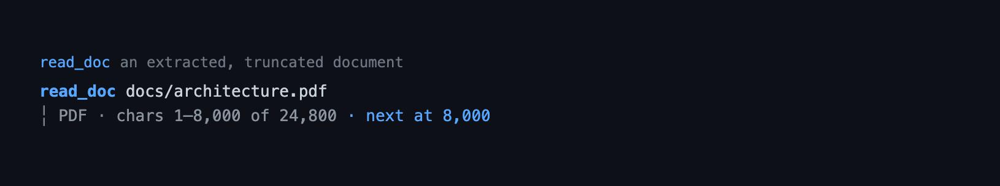

# document — read local PDF, DOCX, DOC, ODT, RTF, and XLSX files as text

`document` adds a `read_doc` tool that extracts plain text from a local `.pdf`,
`.docx`, `.doc`, `.odt`, `.rtf`, or `.xlsx` file, paged with `startIndex` /
`maxChars`. Extraction runs in process through JavaScript libraries (`unpdf`,
`mammoth`, `word-extractor`, `fflate` + `fast-xml-parser`, `rtf-parser`,
`exceljs`); the extension needs no external executable. Reads are confined to
the effective working directory with the same symlink-aware guard the built-in
path tools use.

## Tool rendering

How the `read_doc` call and its result look in the transcript — the call line as a headline and the body indented under it:



## Quickstart

```bash
pi --extension ./extensions/document   # this extension only
pi -e .                                # the package from this checkout
pi install ./                          # install the package for a user
```

The extraction libraries are ordinary dependencies, so a normal install brings
them along. Then ask the model to read a document, or call the tool directly:

```jsonc
{ "path": "docs/spec.pdf" }
{ "path": "docs/spec.pdf", "startIndex": 40000, "maxChars": 40000 }
```

## What it does

- Extracts plain text from `.pdf`, `.docx`, `.doc`, `.odt`, `.rtf`, and `.xlsx`
  files for the model to read.
- Pages long documents: when output is truncated, call again with the
  `startIndex` named in the note.
- Slices by code point, so CJK and emoji stay well-formed.
- Reads only inside the effective working directory, resolving symlinks so a
  link cannot escape it.
- Loads a format's parser only when that format is actually read, so registration
  costs nothing at startup.

## Tool

`read_doc` — direct exposure, active by default, read-only, closed-world
(no network).

| Parameter | Type | Meaning |
|---|---|---|
| `path` | string, required, 1–4096 chars | Path to a `.pdf`, `.docx`, `.doc`, `.odt`, `.rtf`, or `.xlsx`, relative to the working directory (or absolute inside it). |
| `startIndex` | integer ≥ 0 | Code-point offset to start from. Defaults to `0`. |
| `maxChars` | integer 200–100000 | Characters to return. Defaults to the configured `maxChars`. |

Result (`details` / `structuredContent`):

| Field | Meaning |
|---|---|
| `path` | The requested path. |
| `format` | The registry id: `"pdf"`, `"docx"`, `"doc"`, `"odt"`, `"rtf"`, or `"xlsx"`. |
| `bytes` | File size. |
| `chars` | Total characters in the extracted text. |
| `startIndex` | Offset this slice started at. |
| `nextIndex` | Offset to request next when `truncated`. |
| `truncated` | Whether more text remains. |
| `text` | The clean slice, without the header or truncation note. |

The model-facing `content` is a header (`Path:`, `Format:`, `Size:`), a blank
line, the slice, and a truncation note when applicable.

Errors are thrown for: a missing or non-file path, a path outside the root, an
unsupported extension (with a targeted hint for legacy `.xls`), a disabled
format, an over-size file, and a parser that rejects the file. The extension
installs nothing.

## Behaviour by mode

The tool behaves identically in `tui`, RPC, JSON, and print modes; it has no
widgets or status output. `renderCall` / `renderResult` affect only the
interactive transcript (and HTML exports).

The call line carries the path (`~`-shortened, OSC-8 linked when the terminal
supports it) and any paging options. The result line drops the path — it is
already on the call line — and leads with the format and the character range,
grouped so a `k` suffix never sits on one bound and not the other:

```
read_doc ~/docs/spec.pdf (from 40k, max 80k)
PDF · chars 40,001–120,000 of 250,000 · next at 120,000 · ctrl+o
```

Expanded adds a blank line before the preview body, matching the built-in
header/output gap:

```
read_doc ~/docs/spec.pdf (from 40k, max 80k)
PDF · chars 40,001–120,000 of 250,000 · next at 120,000

Chapter 1
This specification defines ...
... (412 more lines)
```

The call line is one physical line: a long path clips in the middle, so the
basename and the paging options survive a narrow terminal. Collapsed rows end
with the expand affordance (`ctrl+o to expand`) when there is text to preview.
Expanded rows append a sanitized, line-capped preview (`PREVIEW_LINES` = 20) of
the extracted text, with `... (N more lines)` when the text is longer; a read
with no extractable text shows the summary only. Errors render as a single
sanitized `error` line, and a partial (streaming) result reads `Reading...` with
a live elapsed suffix. Extracted text is sanitized before a theme colour is
applied, so the theme's own ANSI codes stay intact. A host-rejected call (a
permission block, a validation failure) renders its own message through the same
sanitized error path.

## Configuration

The `document` section of the shared `bytefly.json`, loaded from
`~/.pi/agent/bytefly.json` then `<cwd>/.pi/bytefly.json` (project wins), each
merged over the defaults and clamped:

| Key | Default | Clamp | Meaning |
|---|---|---|---|
| `maxFileBytes` | `20971520` (20 MiB) | 1 KiB – 512 MiB | Reject larger files. |
| `maxChars` | `40000` | 200 – 100000 | Default slice size. |
| `extractTimeoutMs` | `30000` (30 s) | 1 s – 5 min | Per-call extraction deadline; a parser that outlasts it is abandoned. |
| `formats` | `{ "pdf": true, "docx": true, "doc": true, "odt": true, "rtf": true, "xlsx": true }` | — | Per-format on/off, merged over each registry entry's default; unknown keys are ignored. |

```jsonc
// bytefly.json → "document"
{ "maxChars": 80000, "extractTimeoutMs": 60000, "formats": { "docx": false } }
```

`doc.json` is not read, and neither is the old per-extension `document.json`;
run `bun run config:migrate` to move a `document.json` into the shared file.

## Security

- **Local files only.** The tool reads bytes from disk and never opens a socket;
  the parsers work offline.
- **Confined to the effective root.** Relative paths resolve against
  `resolveEffectiveCwd`; absolute paths are allowed only inside it. Containment
  is symlink-aware (`isInsideReal`), and the real, resolved path is what the
  parser receives.
- **Size-capped and time-bounded.** Files larger than `maxFileBytes` are rejected
  before any parser runs, and a parser that outlasts `extractTimeoutMs` is
  abandoned so the turn is not held open by one document.
- **No subprocesses.** Extraction never spawns a process, so it grants no
  privileges beyond the current process.
- **Untrusted text.** Extracted document text is treated as untrusted: it is
  returned as model-facing `content` and data. The collapsed transcript draws
  only a sanitized summary; the expanded transcript draws a sanitized,
  line-capped preview (`PREVIEW_LINES`). Control characters are stripped before
  a theme colour is applied, so raw document bytes never reach the terminal.
- **Worktree guard.** Under the `worktree` extension, `read_doc` is in the
  worktree guard's path-tool map, so `blockReadEscapes` / `blockSymlinkEscapes`
  apply to it exactly as to the built-in `read`.

## Extraction

Each extractor builds a plain-text document from the format's bytes:

| Format | Library | Output normalization |
|---|---|---|
| PDF | `unpdf` (`extractText`, `mergePages: true`) | Every page in reading order, pages separated by a blank line. No OCR: a scanned or image-only PDF yields little or no text. |
| DOCX | `mammoth` (`extractRawText`) | The body story, paragraphs separated by blank lines. Headers, footers, footnotes, and comments are not included. |
| DOC | `word-extractor` (OLE body) | The classic Word body story. |
| ODT | `fflate` + `fast-xml-parser` | `content.xml` is unzipped and walked: paragraphs and headings are lines, table cells are tab-separated, and `text:s` / `text:tab` / `text:line-break` become their whitespace. |
| RTF | `rtf-parser` | Paragraphs are flattened to their span text; formatting is dropped. |
| XLSX | `exceljs` | One `[Sheet]` heading per non-empty worksheet, then tab-separated rows. Dates and numbers use the workbook's displayed text; formulas show their computed value. Cell formatting is dropped. |

The tool is pageable across the whole extracted text, so a word-processing
document or workbook is read in the same `startIndex` / `maxChars` way as a PDF.

Each call is bounded by `extractTimeoutMs` (30 s by default). A parser that
outlasts the deadline is abandoned — the read fails with the limit named, and a
late result is discarded — so a pathological document cannot park the turn.

## Supported formats

| Format | Extensions | Extractor | Enabled by default |
|---|---|---|---|
| PDF | `.pdf` | `unpdf` | yes |
| DOCX | `.docx` | `mammoth` | yes |
| DOC | `.doc` | `word-extractor` | yes |
| ODT | `.odt` | `fflate` + `fast-xml-parser` | yes |
| RTF | `.rtf` | `rtf-parser` | yes |
| XLSX | `.xlsx` | `exceljs` | yes |

## Adding a format

The format table in `formats.ts` is the single source of truth; the handler,
config defaults, and error listing all derive from it.

1. Add the extraction library to `dependencies` in `package.json`.
2. Add `extensions/document/extract/<fmt>.ts` exporting a `DocExtractor` that
   `await import(...)`s its library, reads the bytes with `readDocBytes`, and
   normalizes the output. Keep the parsing in a pure, exported helper so it is
   testable without a real file.
3. Add a `DocumentFormat` entry to `FORMATS` and widen the `id` union.
4. Add `extract/<fmt>.test.ts` with a real minimal fixture, and extend
   `formats.test.ts` / `config.test.ts`.
5. Add a row to the tables above.

`tool.ts`, `paging.ts`, and the config normalizer need no changes.

## Limitations

- Parsing is best-effort and format-specific: output fidelity varies by library,
  and a malformed file fails with that library's message.
- Legacy `.doc` relies on `word-extractor`, which now has a committed OLE fixture
  (`test/helpers/fixtures/files/legacy.doc`, two paragraphs generated once by a
  real word processor). Real Word 6/95 documents vary far more than one fixture
  can show, so the format stays best-effort.
- No OCR: scanned or image-only PDFs return little or no text.
- Formatting, tables, and images are not preserved (XLSX keeps the row/column
  shape but drops cell styling and formulas; DOCX/ODT keep table cells as tabs).
- The deadline stops waiting and discards the result; it cannot preempt a parser
  that never yields to the event loop, because JavaScript cannot interrupt a
  synchronous parse. A worker thread could; the package does not use one.
- `maxChars` limits the returned slice, not peak extraction memory.
- Only one file per call; legacy `.xls` gets a conversion hint.

## Non-goals

- PPTX, EPUB, and plain text (the registry makes new formats additive; plain
  text is the built-in `read`).
- OCR of scanned documents.
- Remote URLs (use `web_fetch`).
- `file-browse` preview integration.
- Writing, summarizing, or converting documents.

## Pi integration

| Aspect | Contract |
|---|---|
| Registration | `document(pi)` in `index.ts` calls `registerDocTool(pi)`, which registers `read_doc`. The factory only registers; no parser loads until a read needs it. |
| Tool | `read_doc`, direct exposure and active on registration (the defaults), default (`parallel`) execution, `annotations: { readOnlyHint: true, openWorldHint: false }`, TypeBox `parameters` and `outputSchema`, and `renderCall`/`renderResult` (reuse `context.lastComponent`; read `context.cwd` and `context.isError`). |
| State | None persisted. Per-result state lives in the tool-result `details` / `structuredContent`; the renderer reads only that. |
| Lifecycle | No `session_start` / `session_shutdown` hooks: each read imports a parser, runs it, and holds no long-lived resources. |
| Host seams | `resolveEffectiveCwd` (`lib/env.ts`), `isInsideReal` / `realPathOfNearest` (`lib/path.ts`), `loadConfigSection` (`lib/config.ts`), `stripControlChars` / `sanitize` / `formatTokens` (`lib/format.ts`), `SEPARATORS` (`lib/tui/glyphs.ts`). |
| Config | The `document` section of the shared `bytefly.json` via `loadConfigSection` (`~/.pi/agent`, `<cwd>/.pi`). |

## Design notes

A separate tool rather than an overload of the built-in `read`: the worktree
extension owns the built-in path tools and re-registers them, so overloading
`read` would fight that machinery. A table-driven registry keeps future formats
additive, and extracting in process means the tool works on any host without a
per-format install step and without spawning a child process per read.

**Parsers load lazily.** The extension registers on every session, so a static
top-level import of `exceljs`, `mammoth`, and `unpdf` would tax every startup,
whether or not a document is ever read. Each extractor therefore imports its
library inside the call (`await import(...)`), matching `web-access`'s lazy
`unpdf` import.

**The XLSX format is rebuilt, not passed through.** `exceljs` exposes worksheets
as objects; the extractor walks every worksheet and reassembles `[Sheet]` + tab
rows so `read_doc`'s model-facing format is stable across extractor changes and
every worksheet is included, not just the first.

The renderer is unchanged and reuses `context.lastComponent` (`Text.setText`),
binding the expand hint to `app.tools.expand`. Path shortening lives in
`render.ts` (not `lib/`): `lib/` helpers are for two or more extensions, and the
built-in-style `~`/boundary rule here is document-only. The result line
deliberately omits the path: Pi stacks the call and result lines in one row, so
repeating it would be pure duplication.

## Files

| File | Responsibility |
|---|---|
| `index.ts` | Factory; registers the tool. |
| `formats.ts` | `DocumentFormat`, the `FORMATS` registry, `FormatId`, `detectFormat`, `supportedExtensions`, `unsupportedHint`. |
| `tool.ts` | The tool definition, handler, path guard, extractor override seam, and renderer wiring. Re-exports `TOOL_NAME`. |
| `render.ts` | Theme-aware transcript formatting: call/result lines, `~` + OSC-8 path, expand hint, sanitized preview, and the shared rejection/error path. The call reuses `ToolCallText` (one line, middle clip); the result reuses `Text`. |
| `schema.ts` | `TOOL_NAME`, `DocParams`, `DocOutput`, limits, result type. |
| `config.ts` | `DocConfig`, registry-derived defaults, `normalizeConfig`, `loadConfig`, `isFormatEnabled`. |
| `paging.ts` | `formatDoc`: code-point slicing and header/truncation formatting; `summarizeDoc`: the theme-free transcript summary. |
| `extract/file.ts` | `DocFile` / `DocExtractor`, `readDocBytes` (abort-aware read), `normalizeBodyText`. |
| `extract/vendor.d.ts` | Ambient types for `word-extractor` and `rtf-parser` (no bundled declarations). |
| `extract/pdf.ts` | `unpdf` extractor and `pdfTextFromResult`. |
| `extract/docx.ts` | `mammoth` extractor. |
| `extract/doc.ts` | `word-extractor` extractor for legacy `.doc`. |
| `extract/odt.ts` | `fflate` + `fast-xml-parser` extractor and `odtXmlToText`. |
| `extract/rtf.ts` | `rtf-parser` extractor and `rtfDocumentToText`. |
| `extract/xlsx.ts` | `exceljs` extractor, `cellToText`, `sheetsToText`. |

## Testing

```bash
bun test extensions/document
```

Extractor tests run against real minimal files (`test/helpers/fixtures/documents.ts`
builds a genuine PDF, DOCX, and ODT; XLSX is written with `exceljs`; legacy `.doc`
reads the committed `files/legacy.doc`), so the libraries are exercised, not
stubbed. `tool.test.ts` injects fake extractors for behavioural cases and reads a
real PDF and a real `.doc` end to end; `test/helpers/fixtures/document.ts`
provides the scratch root and an escape symlink.
