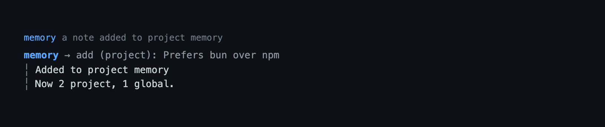

# memory — durable cross-session notes for Pi

A small, model-writable store of short facts that Pi recalls automatically in
later sessions: preferences, environment quirks, conventions, decisions. Notes
live as human-editable markdown, not in the session branch, so they survive
`/new`, `/resume`, and `/tree`. Long-form knowledge still belongs in
`AGENTS.md`; `memory` is for the one-liners the model should not have to be
reminded of twice.


```bash
pi --extension ./extensions/memory    # load just this extension
pi -e .                               # load the whole @gavin-hu/my-pi-agent package
pi install ./                         # install the package
```

## Tool rendering

How the `memory` call and its result look in the transcript — the call line as a headline and the body indented under it:



## What it does

- Registers one model-callable tool, `memory`, with four actions: `add` a note,
  `update` an exact note, `forget` an exact note, or `list` what is stored.
  `add` is a no-op when the note already exists, ignoring case and trailing
  punctuation, so re-stating a fact in new words does not grow the store.
- Keeps two stores, both plain markdown with one bullet per note:

  | Scope | File |
  |---|---|
  | `global` | `<agent-dir>/memory.md` |
  | `project` | `<repo-root>/.pi/memory.md` |

  The project store is anchored at the **repository root**, so it is stable when
  Pi runs from a subdirectory and shared across git worktrees.
- Injects the stored notes as a hidden `[MEMORY]` context message before each
  run, bounded by a byte cap, so the model recalls them without being asked.
- Re-reads each store when its file changes on disk (compared by mtime and size),
  so an external edit lands in the same session without a restart.
- Exposes `/memory`: in the TUI it opens a picker to add, edit, or forget a
  single note, merge two notes into one, move a note to the other scope, filter
  by scope, and reload; elsewhere it lists the store. `/memory path`, `edit`, and `clear` print the file paths,
  open the multi-line editor, and clear a scope; `/memory doctor` reports store
  health.
- Reports store health with `/memory doctor`: note counts and file bytes per
  scope, how much of the `maxInjectBytes` budget the injection uses and which
  scope overflowed it, and the near-duplicate pairs the conservative key already
  considers one fact. It is read-only — the report names the pair and the picker
  merges it.
- Loads and writes the project store only when the project is trusted, sanitizes
  every note to one terminal-safe line, and writes atomically.

## Tool

`memory` is a singleton tool with an action switch (like `job`). It declares an
`outputSchema` and returns matching `structuredContent`
(`{ action, scope, project, global, changed, entry?, to?, existing?, error? }`).

| Field | Value |
|---|---|
| `name` | `memory` |
| `action` | `add` \| `update` \| `forget` \| `list` |
| `text` | The note to add, or the exact note to update or forget. Required for `add`/`update`/`forget`. |
| `to` | The replacement note for `update`. Required for `update`. |
| `scope` | `project` (default) or `global`. Used by `add`/`update`/`forget`. |
| `exposure` | `direct` (default). |
| `executionMode` | `sequential` — calls share the cached stores. |
| `annotations` | `readOnlyHint: false`, `destructiveHint: true` (forget deletes), `idempotentHint: true`, `openWorldHint: false`. |
| `outputSchema` | `MemoryResult` — also returned as `structuredContent`. |

Validation happens before anything is written (a violation returns an error
result carrying the unchanged notes, never a half-apply): a known action; a
non-blank `text` of at most 500 characters for `add`/`update`/`forget`; a
non-blank `to` of at most 500 characters for `update`; an exact match for
`update`/`forget`; and `project` scope only for a trusted project.

Notes are normalized to a single line: control characters (including `ESC`)
become spaces and whitespace runs collapse to one space, so a note cannot inject
terminal sequences when it is injected or rendered. `update` and `forget` match
the trimmed text exactly; `update` replaces every exact match of `text` with `to`
in place (a no-op when they are equal), and `forget` removes every exact match.
`add` skips a note that is already present — exactly, or as a near-duplicate
under the comparison key below — returning the stored note in `existing`, so the
model can call `update` instead of storing a reworded copy.

### Near-duplicate guard

`add` compares the new note against every stored note under a conservative key:
`sanitizeLine` (collapse whitespace, drop control characters), lowercase, then
strip trailing `.`/`!`/`?`/`,`/`;`/`:`. A note that matches is not stored; the
result reports the stored text in `existing`. The key never folds word order,
stemming, or internal punctuation, so distinct facts that merely share a prefix
or stem both survive.

## Commands

| Command | What it does |
|---|---|
| `/memory` | In the TUI, open the picker (add, edit, forget, merge, or move notes; `s`/Tab filters by scope; `r` reloads). Other modes notify the stored notes. |
| `/memory list` | Notify the stored notes and counts. |
| `/memory path` | Notify the two file paths and whether the project store is trusted. |
| `/memory reload` | Re-read the stores from disk and report what changed. |
| `/memory doctor` | Report counts, file bytes, the injection budget with the notes it omits, and near-duplicate pairs. Read-only. |
| `/memory edit [project\|global]` | Open the multi-line editor prefilled with the file and save the result. |
| `/memory clear [project\|global]` | Clear a scope after a confirmation. |

Bulk deletion lives only in the command, behind a confirm — the model cannot wipe
memory in one call.

### Picker keys

| Key | Action |
|---|---|
| `Enter` / `e` | Edit the focused note in the shared inline editor. |
| `a` | Add a note to the active scope. |
| `d` | Forget the focused note after a `y`/`N` confirm. |
| `m` | Mark the focused note as a merge source; `m` on a second note in the same scope opens the editor pre-filled with `"<first>; <second>"`. `m` on the marked note unmarks it. |
| `p` | Move the focused note to the other scope: project → global, or global → project. No confirmation; `p` again moves it back, and a move into an untrusted project is refused. |
| `s` / `Tab` | Cycle the scope filter. |
| `r` | Re-read the stores. |
| `Esc` | Cancel the mark, the editor, or the screen, in that order. |

A merge is one write: the store replaces the first note in place and drops the
second, so a cancelled or failed merge leaves both notes as they were. Two notes
in different scopes are refused — the stores are separate files.

A move is two writes across those files, ordered target first: the note is added
to the destination and only then removed from the source. If the second write
fails the note is in both scopes — a duplicate `/memory doctor` reports and `m`
merges — rather than gone. A note the destination already holds is not
duplicated, and the move still removes it from the source.

## Behaviour by mode

The tool and the context injection work in every mode (`tui`, `rpc`, `json`,
`print`), and `/memory doctor` reports through `notify` everywhere. The picker
opened by a bare `/memory` requires `ctx.mode === "tui"`, and `/memory edit` and
`/memory clear` require `ctx.hasUI`; in JSON and print sessions the command
reports that the interactive form needs a TUI session. Memory itself is external
state, so it is not reconstructed from the session tree and tree navigation does
not change it.

## Configuration

The `memory` section of the shared `bytefly.json`, read from the global
document then the project document (project values override global; missing or
malformed documents are ignored):

| Key | Default | Meaning |
|---|---|---|
| `inject` | `true` | Inject stored notes before each run. |
| `maxInjectBytes` | `8192` | Cap on the injected body, clamped to `512..32768`. |

The tool and command always work; only recall is configured.

## Security

Project memory is repository-controlled text that becomes part of the model's
context, so it is a prompt-injection surface, like `AGENTS.md` or a project
skill. Mitigations:

- The `project` store is read and written only when `ctx.isProjectTrusted()` is
  true. An untrusted project contributes nothing to the injection, and a
  `project` write is rejected with a message steering the model to `global`.
- Every note is sanitized with `stripControlChars` + `sanitize` before storage,
  injection, and rendering.
- Reads are capped at 256 KiB and the injected body at `maxInjectBytes`.
- The path is a fixed constant; a symlink at the memory path is refused.
- The files are ordinary user-owned markdown. They are **not** self-ignored like
  `.pi/plans`, so committing or sharing them is the user's choice; review
  project memory before trusting a repository.

## Limitations

- Notes are injected whole (bounded), so a very large store is truncated with a
  `(+N more; use the memory tool)` tail rather than summarized.
- External edits to a store are picked up automatically by an mtime/size check
  before the next injection or tool call. A same-size edit within one filesystem
  mtime tick is only caught by `/memory reload`; a store that becomes unreadable
  (symlinked or over the size cap) keeps its last good view until fixed.
- Matching for `forget` is exact and case-sensitive.
- The near-duplicate guard on `add` is deliberately conservative: it folds
  case, whitespace runs, and trailing sentence punctuation only, never word
  order, stemming, or internal punctuation. Two paraphrases can therefore still
  both be stored; `/memory doctor` reports the pairs the key does consider equal,
  and `m` in the picker merges them under wording you write.
- `update` replaces every exact match of `text`; a replacement that already
exists under a different note can leave a duplicate. Forget the old note first
when consolidating, or merge the pair in the picker afterward.
- Only one note per line; multi-line notes are collapsed to a single line.

## Non-goals

- No semantic search, embeddings, or a vector store.
- No multi-line or rich notes; long-form knowledge belongs in `AGENTS.md`.
- No per-note ids, priorities, tags, or timestamps.
- No automatic extraction of facts from the transcript.
- No persistent widget; unlike `goal`/`todo`, memory adds no rail.
- No bulk clear through the tool (command-only, confirmed).

## Pi integration

| Contract | Detail |
|---|---|
| Registration | The default export registers the `memory` tool, the `/memory` command, and four event listeners; nothing long-lived. |
| Events | `session_start` loads config and both stores; `before_agent_start` injects the `[MEMORY]` message; `context` keeps only the newest injection; `session_shutdown` clears the cache. The runtime refreshes both stores from their file stamps whenever the notes are read. |
| Tool | direct exposure (the default), `executionMode: "sequential"`, `annotations` and `outputSchema` as above. |
| State | External markdown, **not** branch state: the tool result's `details`/`structuredContent` mirror the call but the notes are read from disk and survive independently of `/resume` and `/tree`. |
| UI | `ctx.ui.notify`, `editor`, and `confirm`, guarded by `ctx.hasUI`, plus the `/memory` picker (`ctx.ui.custom`) in the TUI. |
| Plan mode | Blocked — `plan`'s read-only policy allows only `readOnlyHint` tools, so memory cannot be mutated while planning; recall still works. |

## Design notes

- **Health reads the injection it describes.** `injectionPlan` is the same
  cap arithmetic `buildInjection` joins into the context body, so the doctor
  cannot claim notes fit while recall drops them; `buildInjection` is a join over
  that plan, which is why the report needed no second budget model.
- **A merge is one transform.** `applyMerge` replaces the first note and drops
  the second inside the same read-modify-write the other mutations use, so a
  cancelled or failed merge cannot leave one note gone and the other not. The
  editor is pre-filled with both notes, but the wording saved is the user's — the
  duplicate rule stays conservative and nothing is folded automatically.
- **External storage, deliberately.** `goal`/`todo` keep state in tool-result
  `details` because it follows the active branch. Memory is the opposite: it must
  outlive the branch and be editable outside Pi, so it is plain files read at
  session start (`lib/README.md`'s "data outside one session — external
  storage").
- **A message, not the system prompt.** The injection follows the established
  `goal`/`plan`/`job` pattern: a hidden custom message, deduplicated by a
  `context` handler, re-added each run so edits are reflected without a reload.
- **Repo-root anchor.** Resolving the project store with `lib/git`'s
  `repoRootFor` matches `plan/plans.ts` and keeps worktrees from stranding notes.
- **Read-modify-write under a queue.** Host `withFileMutationQueue` serializes
  writers for the same file, and each write lands atomically via a temp file and
  rename; `executionMode: "sequential"` keeps in-process calls ordered as well.
- **Stamped cache, not a watcher.** The session cache is validated against each
  file's `(mtimeMs, size)` stamp before every read, matching the worktree cache's
  freshness check rather than holding an `fs.watch` handle. A mutation adopts the
  fresh on-disk stamp, so a self-write is not mistaken for an external change, and
  a failed re-read keeps the last good view instead of breaking the run.

## Files

| File | Responsibility |
|---|---|
| `index.ts` | Factory: guard, register tool/command, session wiring and injection. |
| `types.ts` | `MemoryScope`, `MemoryAction`, `MemoryDetails`, the context type. |
| `config.ts` | Defaults and the `memory` section of `bytefly.json` loading/clamping. |
| `schema.ts` | TypeBox params/result and pure validation of action, scope, and text. |
| `store.ts` | Paths, parse/read, file stamps, add/update/forget/merge/clear transforms, atomic queued write. |
| `doctor.ts` | The health report (pure): counts, file bytes, the injection plan's omissions, and near-duplicate pairs. |
| `runtime.ts` | Session view of both stores, stamp-based refresh, trust gating, mutations. |
| `format.ts` | Pure call/result/notice text and the bounded injection body. |
| `errors.ts` | `messageOf`, the shared error-text extraction for the tool and command. |
| `tui.ts` | The `/memory` picker component (note list, inline editor, merge mark, scope move, scope filter), drawn from the `lib/tui/` kit (`titleRule`, `dockListFrame`, `listRow`, `emptyState`). |
| `tools.ts` | `registerTool("memory", …)`. |
| `commands.ts` | `registerCommand("memory", …)`. |

## Testing

`bun test extensions/memory` covers the pure store transforms (including the
near-duplicate comparison key and the `add` guard), file stamps, schema and
config validation, formatting/injection truncation, the `/memory` picker
(`tui.test.ts`: rendering, navigation, scope filter, inline add/edit, forget
confirm, trust), and the extension surface (registration, `session_start`
loading, injection and dedup, external-edit refresh, `/memory reload`, update
and trust gating, and the `/memory` command) through the
`test/helpers/fixtures/memory.ts` suite harness.
