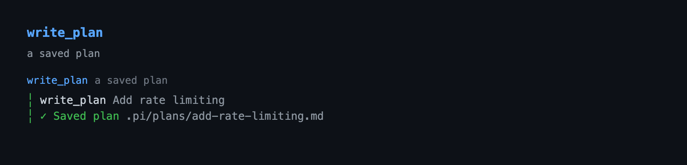
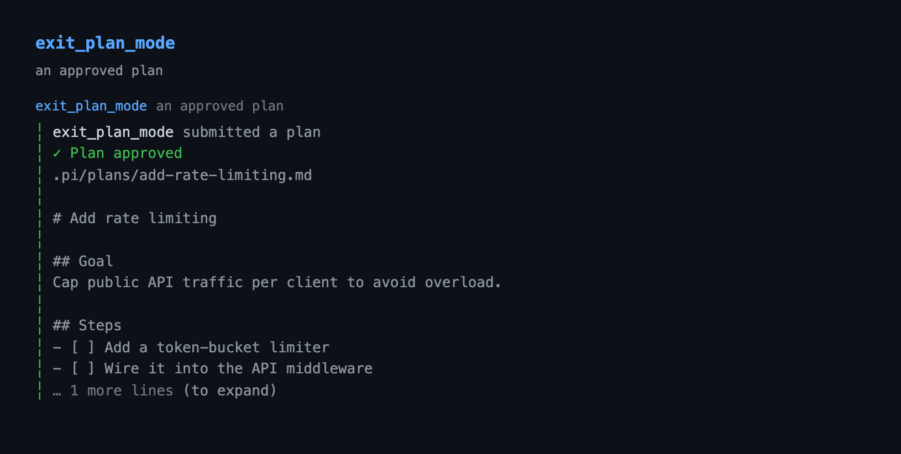
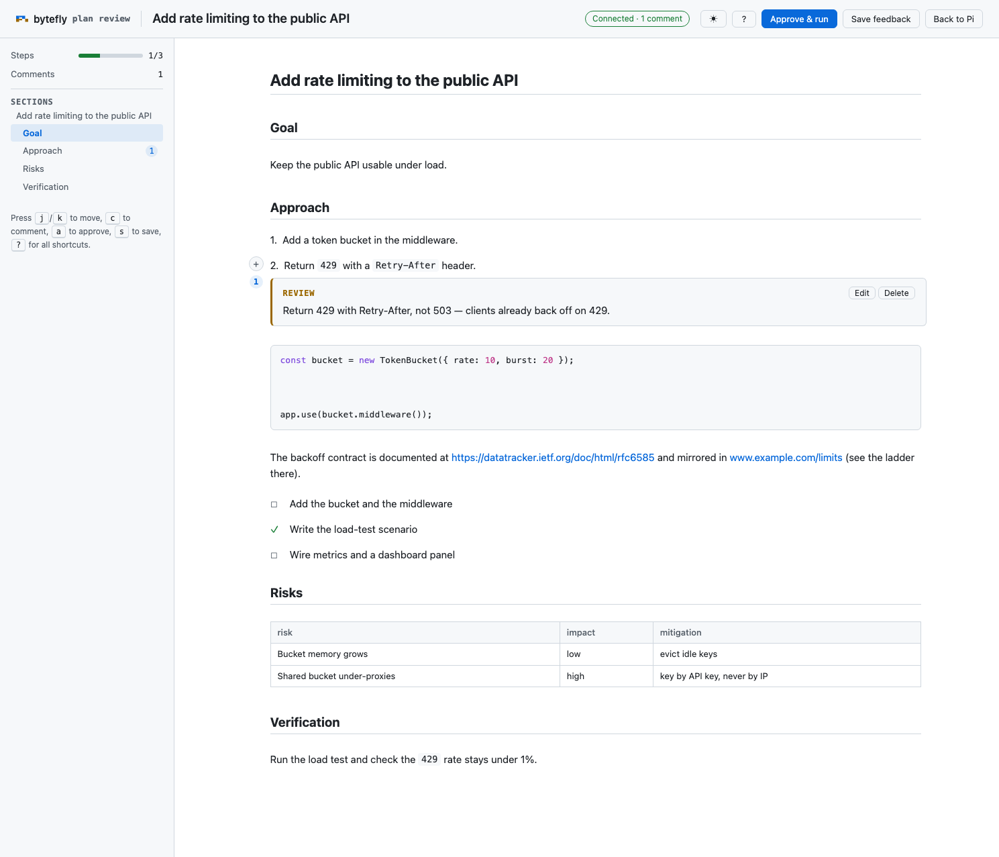

# plan — file-backed planning for Pi

A read-only exploration mode modelled on Claude Code's `EnterPlanMode` /
`ExitPlanMode` pair. While plan mode is on, the model investigates and proposes,
but the only thing it may write is the plan file itself. The plan is saved under
`.pi/plans`; the user reviews that file, and it is the artifact the model
executes.

```bash
pi --extension ./extensions/plan   # load just this extension
pi -e .                            # load the whole @gavin-hu/my-pi-agent package
pi --plan                          # start in plan mode
```

## Tool rendering

How the `write_plan` and `exit_plan_mode` calls and their results look in the transcript — the shared rail around each tool's own renderer:





## What it does

- **Read-only gating, with one exception.** Tools that are not read-only are
  removed from the active set or blocked. `write` and `edit` are hidden, raw
  shell is limited to read-only git commands through `bash` (chained with
  `&&`/`;`), `powershell` is blocked outright, and other mutating tools (worktree
  mutations, MCP tools) are blocked until you exit plan mode. `subagent` stays
  active but is forced read-only. The only permitted write is the plan control
  tool `write_plan`, which can only create or overwrite markdown plan files
  directly inside the plans directory — never dotfiles and never through a
  symlink. Classification defaults to *deny* and is driven by the shared
  [`lib/policy.ts`](../../lib/policy.ts), so unknown tools are safe by default
  and the MCP `readOnlyHint` is the only thing that opens one up. A refused
  shell command explains the fix: the working directory is already the project
  root (so `cd` is unnecessary), and files belong to the `read`, `grep`, `find`,
  and `ls` tools.
- **Model entry point.** The model can call `enter_plan_mode` to ask for plan
  mode before a non-trivial task; the user confirms.
- **Plan files.** The model saves the plan with `write_plan`; the file lands in
  `<repo-root>/.pi/plans/<YYYY-MM-DD-HHmm>-<slug>.md` (or `<agent-dir>/plans`
  outside a repository). The plans directory is self-ignoring, so plan files
  never show up as untracked files or in `rewind` snapshots.
- **A shape that reads.** `write_plan` documents a canonical outline — a
  `# <Title>`, then `## Goal`, `## Context`, `## Approach`, `## Steps`,
  `## Risks`, and `## Verification` — and the model is guided to follow it. This
  is guidance only: any markdown is accepted, stored, and rendered as written.
- **Trackable steps.** Steps are written as `- [ ]` checkboxes; approval seeds
  them into `todo`.
- **A navigable review.** The review screen splits the body at its headings,
  names the section you are in, and jumps between sections with `n`/`p`.
- **Kept current.** After approval, `set_plan_steps` flips the checkboxes of
  the steps you name in the file, so the plan mirrors what has actually been
  done.
- **Reviewable plan.** `exit_plan_mode` reads the plan file back and presents
  it for approval. The user approves, keeps planning, or asks for a refinement.
- **Browser review on demand.** Press `w` on the review screen (or run
  `/plan review [path]`) to open the plan in a local browser: a reading-first
  page with the plan's H1 as its title, GitHub's Markdown content column, a
  comment rail in
  the left margin, and live section and step progress. Select text to leave an
  inline comment, and save them back into the plan file itself as
  `> [!REVIEW]` lines. Saved comments return to the model as a refinement
  request.
- **The file is the source of truth.** On approval the model follows the plan
  file's steps; refinements rewrite the same file (`write_plan` with
  `plan_path`), so the reviewed artifact is the executed artifact.
- **Steps become todos.** On approval, the plan's top-level numbered/bulleted
  steps are recorded with the `todo` tool (via `ctx.executeTool`); steps marked
  `- [x]` (or `[DONE:n]`) seed as completed, and nested sub-bullets are treated
  as notes.
- **Branch-aware.** The enabled flag is a custom session entry, so `/resume` and
  `/tree` restore the right mode.

## Tools

| Tool | Active | Purpose |
|---|---|---|
| `enter_plan_mode` | normal mode | Ask to enter plan mode; empty schema, confirmed with `ctx.ui.confirm`. |
| `write_plan` | plan mode | Save the plan: `title` (file-name slug), `content` (full markdown in the documented outline), optional `plan_path` to overwrite a refinement. Returns the absolute path. |
| `exit_plan_mode` | plan mode | Read the plan file (`plan_path`) and present it for approval. |
| `set_plan_steps` | normal mode | Keep an approved plan current: set the checkboxes of the given top-level steps (`updates`, each a 1-based `step` in the order `exit_plan_mode` listed, plus `status`) to `pending` or `completed` in one write. Only the checkboxes change, and a reopened step drops its `[DONE:n]` marker. |

### Commands and flags

| Path | Who starts it | Confirmation |
|---|---|---|
| `enter_plan_mode` tool | the model, before a non-trivial task | `ctx.ui.confirm` |
| `/plan` | the user | immediate |
| `/plan <prompt>` | the user, with the task | immediate |
| `/plan review [path]` | the user, reviewing a plan in the browser | immediate |
| `Ctrl+Alt+P` | the user | immediate |
| `--plan` | the user, at launch | immediate |

`/plan` with no argument toggles plan mode; `/plan <prompt>` enters it (if it is
not already on) and sends the rest of the line as the task, so the first turn
already runs read-only:

```bash
/plan add rate limiting to the public API
```

`/plan <prompt>` never disables plan mode; only the argument-less `/plan` (or
`Ctrl+Alt+P`) toggles. Because slash commands go through Pi directly, `/plan` is
the toggle that works in every terminal (for example Zed's integrated terminal,
which does not forward `Ctrl+Alt+P`). The footer shows `⋮ plan` while plan mode
is on, and `⋮ plan · <plan-file>` once the model has written a plan.

`/plan review` is the one reserved subcommand. Bare `/plan review` reviews the
most recent plan; `/plan review <path>.md` (or a path with a separator) reviews
that plan. A line that merely starts with the word — `review the auth flow` — is
still treated as a planning task, so the subcommand never swallows one.

## Behaviour by mode

The review screen is TUI-only. `exit_plan_mode` opens `PlanViewComponent`: a
scrollable, width-safe view of the plan with approve/refine/keep in the footer.
The body is rendered with Pi's own `Markdown` component and `getMarkdownTheme()`,
so headings, lists, inline code, code blocks, links, and quotes carry the active
theme's colors; task items get the shared `◼` (done) or `◻` (pending) marker,
like the bytefly screen and the question dialog. The footer colors the primary
actions (`a approve & run` in `success`, `r refine` in `accent`).
`a` ends plan mode, restores write access, and seeds `todo`; `r` keeps the plan
mounted and opens an inline editor beneath it (`Enter` submits, an empty buffer
does nothing, `Esc` returns to the plan); `Esc` keeps planning and tells the
model the plan was not approved. Scroll with `↑`/`↓` or `j`/`k`, `space`/`b` or
`PgUp`/`PgDn`, `d`/`u`, `g`/`G`, and the mouse wheel. Press `n`/`p` to jump to
the next or previous heading; the scroll row names the current section when the
plan has more than one. When the plan overflows,
a gauge row above the hints shows the scroll position, the percent, and the
visible line range (the range drops first on a narrow terminal); the gauge comes
from the design system's `gaugeBar` and stays
visible while the refine editor is open, since the body above is still clipped.
Hints are
dropped whole as the terminal narrows, and each footer leads with its safe exit
(`Esc keep planning` in the review, `Esc back to plan` in the inline editor) so
the exit survives even when only one hint fits.

Dialog-capable non-TUI modes (RPC) show the same three choices as a select menu
plus the refine editor; cancelling the editor returns to the select instead of
being reported as "not approved". A WeChat turn takes the same dialog path and
is answered over WeChat, even though the session is in TUI mode: the choice
comes from `askHuman(ctx, { custom, dialogs, file, body })` in
`lib/interaction.ts`, not from `ctx.mode`. A remote turn also receives the plan
**file** first (falling back to the plan text if the upload fails) so the whole
plan is reviewable there; RPC has no channel and still sees only the choices.
Without any UI the tools fail with an actionable message instead of deciding for
the user.

Browser review is a local-turn feature: the server binds `127.0.0.1`, so a remote
(WeChat) turn cannot reach it and `/plan review` there refuses with a notice
instead of opening a server nobody can use. The browser's **Approve & run** is
offered only for the review `exit_plan_mode` opens, since only that flow owns
leaving plan mode; `/plan review` stays comment-only.

### Transcript

The three tool rows reuse the transcript component, and `exit_plan_mode`
separates the plan body from its header with a blank line; the collapse hint
binds to `app.tools.expand` (`ctrl+o` by default).

```
enter_plan_mode requested plan mode
✓ Plan mode enabled
```

```
write_plan Add rate limiting
✓ Saved plan .pi/plans/2026-10-09-1809-add-rate-limiting.md
```

```
exit_plan_mode submitted a plan
✓ Plan approved
.pi/plans/2026-10-09-1809-add-rate-limiting.md

# Add rate limiting
1. Add a token bucket …

… 12 more lines (ctrl+o to expand)
```

## Security

Plan mode is a **guard rail, not a sandbox**: extensions run with Pi's OS
permissions, so it prevents accidental writes while planning, not a hostile
command. The read-only guarantee is layered:

- **Capability policy.** A tool is allowed only when it is a known structured
  reader or declares the MCP `readOnlyHint`; `write`, `edit`, and unknown
  mutators are denied.
- **Path backstop.** A `readOnlyHint` is only a claim, so a tool that takes a
  file path is refused unless it is a known plan-safe reader. `path-guard.ts`
  scans nested arguments and path-shaped values, not just fixed top-level keys.
- **Control-tool identity.** The `tool_call` guard exempts `write_plan` /
  `exit_plan_mode` only when the registered tool is this extension's own,
  matched by source path, so a same-named tool from another extension cannot
  borrow the exemption.
- **Contained writes.** `write_plan` only writes markdown non-dotfiles whose
  real parent resolves inside the plans directory.
- **Sanitized model text.** The plan file is model-authored, so `exit_plan_mode`
  strips control characters from the plan body before rendering it in the
  transcript and in non-TUI notices; a plan file cannot drive the terminal.
- **Loopback browser review.** The review server binds `127.0.0.1` and requires a
  random per-session token in the URL, rejects a missing or foreign `Host`
  header, serves only `GET`/`POST`, and caps the request body; the page renders plan and comment text
  with DOM text nodes, never `innerHTML`, so a plan cannot script the reviewer.

## Read-only git shell

Plan mode does not run a general shell. `bash` stays active only so the model
can run **read-only git commands** — for example `git status`,
`git diff --stat`, `git log --oneline`, `git show HEAD`, or `git branch -a`.
Several may be chained with `&&` or `;` in one call, but every segment must
itself be a read-only git command, so a chain only combines allowed reads.
Anything else (a non-git command, a mutating git subcommand, a piped or
redirected command, substitution, or a conditional `||`) is blocked by a
conservative allowlist in `git-bash.ts`. `powershell` is not allowed at all, so
plan mode uses Git Bash on native Windows: the same read-only git commands work
there, and a backslash before an ordinary character is accepted as a Windows
path separator while a backslash that escapes a metacharacter is still refused.
Everything else uses `read`, `grep`, `find`,
`ls`, and the other read-only tools already available (`web_search`,
`web_fetch`, `ask_user_question`, `todo`, `goal`).

```bash
git status && git diff --stat     # allowed: two read-only git commands
git status; git log --oneline -5  # allowed
git diff -- extensions\plan      # allowed: a Windows path separator
git status && rm -rf x            # blocked: the second segment is not git
git status | sh                   # blocked: pipes are never allowed
git diff > out.patch              # blocked: redirection is a write
```

A string parser can never be the boundary, so capability gating replaced the
earlier segment-based command allowlist. The git shell guard is a narrow,
deliberate exception — an allowlist over read-only git command shapes, not a
general shell parser. If you need anything else during a plan, exit plan mode
first or wait for approval.

## Read-only delegation

While planning, `subagent` stays available but every call is **forced
read-only**. Plan mode sets `readOnly: true` on the call in the `tool_call`
guard, and `subagent` in turn gives each spawned agent a reader-only `--tools`
list (`read`, `grep`, `find`, `ls`, `web_search`, `web_fetch`). The child
process enforces it, so a delegated `explorer`, `researcher`, or even `worker`
cannot write, edit, or run a shell — regardless of its prompt or an external
agent file that overrides it.

```jsonc
// The model just calls subagent; plan mode supplies the readOnly flag.
{ "agent": "explorer", "task": "Map how the plan extension gates tools" }
```

- A `subagent` whose registered schema does not declare `readOnly` is refused
  (default-deny), so an old or unrelated tool cannot be run read-write while
  planning.
- The delegated run keeps its own isolated context window, so broad exploration
  does not fill the planning session.
- `readOnly` is also a normal `subagent` parameter; outside plan mode a caller
  may set it to run any agent read-only on purpose.

## Browser review



Press `w` on the review screen — or run `/plan review [path]` — to open the plan
in the default browser on `127.0.0.1`. The page is a reading-first review
surface: a sticky header carrying the plan's H1 (falling back to the file-name
slug), a live status chip (connection, comment count, and unsaved changes), the
theme toggle, and the review actions, over a hairline reading-progress bar. A
sticky side panel shows the plan's step progress and comment count above a
**section outline**, and the document is GitHub's Markdown content column — one centred
measure of at most 1012px with a comment rail in its left margin. Every block
reveals a **+ Comment** action on hover; select
text first to quote it. **Save feedback** writes the comments into the plan
file and returns them to the model.

- **Shared theme.** The page uses the same Bytefly tokens, base rules, and
  syntax-token colors as `file-browse` (`lib/web/`), follows the system light/dark
  preference until the header toggle sets an explicit choice, and remembers that
  choice under the shared `pi-web-theme` key.
- **One content column, one rail.** The document is GitHub's Markdown content
  column (a centred measure of at most 1012px), so a plan reads the way the same
  file does on GitHub; each block carries its `+ Comment` button and
  comment-count badge
  in a rail in the left margin, so annotating never reflows the text.
- **Section outline and facts.** Headings become a sticky outline with jump
  links, an active-section highlight, and a per-section comment count; the panel
  above it reports the plan's checkbox steps (`n/m`) and total comments.
- **Inline threads.** A comment renders directly under the block it anchors to,
  labelled and indented as a thread, so it reads in place and the plan keeps one
  measure at every width. There is no separate column to reflow.
- **Keyboard first.** `j`/`k` move to the next or previous block, `c` comments
  on the current block, `a` approves (the approval flow only), `s` saves, `Esc`
  closes the composer or the sheet and then the review, and `?` opens a shortcut
  sheet; the header's `?` button opens the same sheet.
- **Decision in place.** A review opened for approval (`w` on the review screen)
  shows **Approve & run** beside Save feedback: it persists the current comments,
  ends plan mode, restores write access, seeds `todo`, and hands control back to
  the model. **Save feedback** keeps plan mode and returns the comments as a
  refinement; **Back to Pi** closes the review with no decision. Each action
  settles the page on a terminal state — `Approved`, `Saved`, or `Closed` — so
  the tab never falls to Offline. `/plan review` is comment-only: it renders no
  approve action and the server refuses one.
- **Markdown that reads.** Headings, lists, task items, blockquotes, fenced
  code, GFM tables, `---` rules, and bare-URL autolinks render; a list item's
  continuation lines hang under the item's text, inline code is a soft fill
  rather than a bordered chip, tables honour the alignment row and scroll
  horizontally when narrow.
- **Highlighted code.** Fenced code is tokenized by the shared
  `lib/highlight.ts`; the client copies only text and `tok-*` spans through
  `DOMParser`, so a code line is never parsed as markup.

- **The file is the store.** Each comment is written as
  `> [!REVIEW] <comment>` on the line after the block it anchors to. Saving is
  idempotent: the previous markers are stripped first, so a second save replaces
  rather than appends. Stripping is fence-aware: a `> [!REVIEW]` line inside a
  code block is documentation, not feedback. The browser keeps no copy of its own.
- **Anchored to source.** `blocks.ts` splits the plan (fence-aware) into
  source-line ranges; a comment is placed after the whole anchored block, so a
  fenced code block is never split. A save re-checks the file against what the
  page rendered and answers `409`; the page then offers a **Reload** action,
  because only a reload can re-anchor the comments to the new text.
- **Back to the model.** A save from the review screen returns `refined: true`
  with the comments, so the model stays in plan mode and revises the same file.
  `/plan review` sends them as a user message (a plan-mode revision or a plain
  update, depending on the mode).
- **Loopback and tokenized.** The server binds `127.0.0.1`, carries a random
  per-session token in the URL, rejects a missing or foreign `Host` header,
  serves only `GET` and `POST`, and caps the request body. A save or cancel
  resolves the session only after its HTTP response is delivered, so the browser
  never sees a false "Failed to fetch". The last bound port is remembered per
  plan, so reviewing the same plan again reuses the origin (and the browser's
  saved theme with it). It is closed on save, cancel, tab close, or
  `session_shutdown`.

| Route | Result |
|---|---|
| `GET /?token=…` | the review page (a JSON data island plus `/theme.js` and `/client.js`) |
| `GET /theme.js` | the shared pre-paint theme bootstrap |
| `GET /client.js` | the first-party client script |
| `GET /events?token=…` | Server-Sent Events stream, used only to detect a closed tab |
| `POST /api/feedback?token=…` | validate and write the annotations into the plan |
| `POST /api/cancel?token=…` | end the session without saving |

## Limitations

- PowerShell is not available while planning. On native Windows the shell is
  Git Bash (`bash`), which must be installed for any shell command to run.
- The read-only guarantee is a guard rail against accidental writes, not a
  security boundary (see [Security](#security)).
- The plans directory is the only index; there is no registry and no persisted
  plan metadata.
- Browser review needs a local browser: the server is loopback-only, so a remote
  turn cannot drive it.
- A browser that never connects leaves the review waiting until the user
  cancels, closes the tab, or aborts the turn.
- Feedback stripping follows fenced code blocks; an unterminated fence makes the
  rest of the file code, so a marker-looking line after it is treated as content
  rather than stored feedback.

## Non-goals

- **Not a sandbox.** Extensions share Pi's OS permissions.
- **No progress tracker of record.** `todo` owns completion state; the plan
  file only mirrors it (`set_plan_steps`), and plan mode does not read completion
  back out.
- **No auto-execution.** Approval hands control back to the model.

## Pi integration

| Integration point | How |
|---|---|
| Tools | `enter_plan_mode`, `write_plan`, `exit_plan_mode`, and `set_plan_steps` registered with `executionMode: "sequential"`. `enter_plan_mode` is active normally with `readOnlyHint: true`; `write_plan` (`readOnlyHint: false`) and `exit_plan_mode` (`readOnlyHint: true`) are `defaultActive: false`. `set_plan_steps` is active normally (`readOnlyHint: false`, `idempotentHint: true`); the read-only policy default-denies it in plan mode. Each returns typed `details` (`EnterPlanModeDetails`, `WritePlanDetails`, `ExitPlanModeDetails`, `SetPlanStepsDetails`); no `outputSchema`/`structuredContent`. |
| Commands and flags | `/plan` (toggle, or enter and send a task), `/plan review [path]` (browser review), `--plan` launch flag, `Ctrl+Alt+P` shortcut. |
| State | Enabled flag and the tools it hid persisted with `pi.appendEntry("plan-mode", { enabled, removed })` and rebuilt from `ctx.sessionManager.getBranch()`; the last plan path lives in runtime memory for the footer chip. |
| Hooks | `tool_call` blocks non-read-only calls and forces `subagent` read-only; `before_agent_start` injects the hidden `[PLAN MODE ACTIVE]` context; `context` keeps only the newest plan context while enabled and drops stale ones otherwise. |
| Lifecycle | `session_start`/`session_tree` restore state; `session_shutdown` clears the footer status and closes any browser review server. |

## Design notes

- **Two tools, not one.** `EnterPlanMode`/`ExitPlanMode` are a pair: entering is
  consent to explore read-only, exiting is consent to act. A single toggle tool
  cannot express "the model wants to plan but the user declines".
- **User entry is instant, model entry confirmed.** `/plan`, `Ctrl+Alt+P`, and
  `--plan` are the user's own action and take effect at once; `enter_plan_mode`
  changes the mode on the user's behalf, so it confirms first.
- **Review the file, decide in a screen.** The plan is a file, so it is the
  artifact already on screen. `ctx.ui.confirm()` is a non-scrollable selector
  that pushes buttons off-screen for a long plan, so the TUI gets a scrollable
  review screen and dialog-capable modes get a `select` plus editor. The screen
  renders the body with Pi's `Markdown` component so the plan reads like any
  other markdown in the app; the plan text is sanitized before it reaches the
  renderer, so only the theme's own ANSI survives.
- **`write_plan` is the only write.** It is not the builtin `write`, so the
  capability policy and path backstop stay intact; a `plan_path` must name a
  markdown non-dotfile whose real parent resolves inside the plans directory,
  so symlinks and the directory's own `.gitignore` are never writable targets.
- **Approval seeds `todo` via `ctx.executeTool`.** The event bus carries no
  `ctx`, so a listener could not refresh the todo widget; calling the real tool
  runs its validation and widget sync and needs no change to `todo`. Only
  top-level list items become steps. A rejected seed reports the nested tool's
  own reason in the approval message instead of failing silently.
- **The outline guides, it does not enforce.** `write_plan` documents the
  canonical shape in its description and stores whatever markdown it is given;
  no section is required and nothing is rewritten. That keeps the model free to
  adapt the document while making the common case consistent and scannable.
- **Sections are rendered one at a time.** Pi's `Markdown` exposes no
  source-line map, so `tui.ts` splits the body at its headings and renders each
  section separately. That gives exact offsets for the current-section label and
  `n`/`p`; the single-section case is byte-for-byte the old render.
- **`set_plan_steps` is a second contained write.** It changes only the named
  steps' checkboxes, in an existing markdown plan inside the plans directory
  (`isContainedPlan`), in a single all-or-nothing write — refusing every entry
  if any step is out of range — and refuses while plan mode is on, so the
  read-only guarantee and the path backstop are unchanged.
- **Direction: enforce capabilities at the tool boundary.** (1) A shared
  default-deny policy classifies every call as read-only or mutating instead of
  maintaining a mutator list. (2) Read-only delegation is enforced in the child
  process through `--tools`, not by trusting the agent name or prompt. (3) Raw
  shell is removed except the narrow read-only git allowlist in `git-bash.ts`;
  no general shell parser. (4) A recursive path guard blocks hint-carrying tools
  that take a file path unless they are known plan-safe readers.
- **State is a custom entry.** `{ enabled, removed }` is excluded from model
  context and reconstructed on start and tree navigation, so exiting plan mode
  restores the tools the branch it was left on hid; the `--plan` flag only
  applies when the branch has no persisted entry, so a later disable survives
  `/resume`.
- **Browser comments live in the plan, not a sidecar.** A review comment is a
  blockquote in the file the model already owns, so there is one artifact to
  read, revise, and approve; `blocks.ts` supplies the source-line anchors the
  existing heading-only split cannot, and the page renders text with DOM nodes
  so review never widens the plan's trust surface. The browser opener is shared
  through `lib/browser.ts` rather than imported from `file-browse`.
- **Comments render in the document flow, not a second column.** The anchor is
  already a source line, so the browser needs no paired column: a thread is
  appended after its block and the plan keeps one measure at every width. The
  per-block affordance lives in a narrow rail inside the measure's left margin,
  so annotating never moves the text. That removes the two-column grid, the
  `bf-review--no-rail` collapse, and the breakpoint ladder, and matches the TUI,
  where neither review header carries a progress counter.

## Files

| File | Responsibility |
|---|---|
| `index.ts` | Wiring: tools, command, flag, shortcut, events, context injection. |
| `types.ts` | `PlanModeEntry`, `EnterPlanModeDetails`, `WritePlanDetails`, `ExitPlanModeDetails`, `SetPlanStepsDetails`. |
| `policy.ts` | Plan mode's read-only policy, the shared prompt summary, and the bash-refusal guidance. |
| `git-bash.ts` | `checkReadOnlyGit`: the pure allowlist that restricts `bash` to read-only git commands. |
| `plans.ts` | Plan-file store: slug/stamp naming, directory resolution, containment, write/read/`setSteps`/`saveFeedback`. |
| `steps.ts` | Plan-document structure (pure): the outline, step extraction, heading sections, and the checkbox edit. |
| `runtime.ts` | Enabled state, tool gating, persistence, control-tool identity, footer status. |
| `tools.ts` | `enter_plan_mode`, `write_plan`, `exit_plan_mode`, and `set_plan_steps`. |
| `commands.ts` | `/plan` (enter, optional task) and the `/plan review [path]` browser subcommand. |
| `tui.ts` | `PlanViewComponent` (sectioned Markdown body, section jump, scroll gauge, approve/refine/browser/keep). |
| `blocks.ts` | Source-line block model (fence-aware headings, paragraphs, list items, code, quotes, tables, rules, blanks). |
| `feedback.ts` | Browser-comment codec: `stripFeedback`, `parseFeedback`, `formatFeedback`, `feedbackSummary`, and payload validation. |
| `web.ts` | `createPlanWebReview`: the loopback server, the section outline and code highlighting, and the save/approve/cancel/abort session. |
| `web-router.ts` | Pure request handler: token/`Host`/method checks and the review routes. |
| `web-page.ts` | The review page shell (header, reading progress, review facts, section outline, shortcut sheet), its data island, and inline CSS. |
| `web-client.ts` | The `/client.js` source (block/thread rendering, the comment rail, outline and facts, inline comments, selection quotes, tables, highlighted code, keyboard nav, save/approve/back). |
| `path-guard.ts` | Recursive path-argument detection for the read-only backstop. |
| [`../../lib/browser.ts`](../../lib/browser.ts) | Cross-platform default-browser opener (shared with `file-browse`). |
| [`../../lib/highlight.ts`](../../lib/highlight.ts) | First-party escape-first syntax tokenizer (shared with `file-browse`). |
| [`../../lib/web/index.ts`](../../lib/web/index.ts) | Shared Bytefly web brand system: tokens, base rules, `tok-*` colors, layout, the bootstrap, the toggle wiring, and shared markup. |
| `../../lib/policy.ts` | Shared read-only capability policy (default-deny + `readOnlyHint`). |
| `../../lib/tui/chrome.ts` | Shared screen header, viewport-row helper, and styled key-hint footer. |
