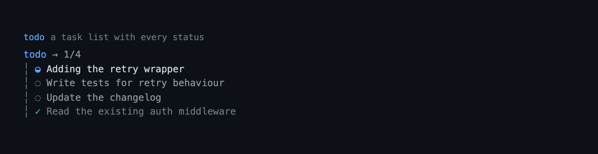

# todo — a TodoWrite-style task list for Pi

A whole-list task tracker for Pi, modelled on Claude Code's `TodoWrite`. The
model sends the complete list on every call; the previous list is discarded, so
there are no ids to juggle and no add/toggle bookkeeping. The list follows the
active session branch and is restored on `/resume` and `/tree`. When a run is
about to end after mutating work without a todo update, the extension injects
one short reminder and forces a continuation, so the list does not silently
drift behind the work.


```
pi --extension ./extensions/todo    # load just this extension
pi -e .                             # load the whole @gavin-hu/my-pi-agent package
pi install ./                       # install the package
```

## Tool rendering

How the `todo` call and its result look in the transcript — the call line as a headline and the body indented under it:



## What it does

- Registers one model-callable tool, `todo`, that **replaces** the task list.
  An empty list clears it. The tool result is a compact summary — progress plus
  the current item — not an echo of the list the model just sent.
- Each item has `content`, a `status` (`pending` | `in_progress` |
  `completed`), and an optional `activeForm` ("Running tests") shown while the
  item is in progress.
- Shows a persistent widget above the editor while the list has unfinished
  work (hidden when empty or fully completed), and a scrollable `/todos`
  screen on demand. It is the bottom rail, below the [`goal`](../goal/) widget
  (`Goal / Todos`).
- Stores the list in tool-result `details`, so it follows the active session
  branch and survives `/resume` and `/tree` — abandoned branches never leak
  into the current list, and stored lists are re-sanitized on replay.
- Keeps the list honest: when a run is about to settle after a successful
  mutating tool call (`write`/`edit`/`bash`/`powershell`, or a tool declaring
  `readOnlyHint: false`) without a todo update, it injects one hidden reminder
  and forces a single continuation. A failed or blocked call changed nothing, so
  it never triggers one. It fires while the list has unfinished items, and —
  when no list exists at all — only after three such calls in one turn, because
  one edit is not evidence that the work needed a plan. A list the model wrote
  or cleared during the turn is left alone. At most one reminder per user turn,
  and it is dropped on the next user turn, so a reader can never trigger it.
- Declares an `outputSchema` and returns matching `structuredContent`
  (`{ todos, action, error? }`), so codemode/scripts can read the list as data.

The widget is a one-line summary — progress plus the current item — so the
active task is always visible without expanding the list:

```
Todos · 1/3 · Writing the tests
```

`/todos` is the expanded view and keeps the model's list order (use it to see
the plan as written).

In the transcript, the call line carries progress only (`todo → 1/4`); the
result keeps the `✓` / `◒` / `◌` rows, directly under the call line. The item
text lives on the rows, so the call line never repeats it. Collapsed, it leads
with active work; expanded, it keeps the submitted order:

```
todo → 1/4
  ◒ Writing tests
  ◌ Ship it
  ◌ Write docs
  ✓ Write schema
```

Progress lives on the call line, so the rows have no footer; the persistent
widget and `/todos` still show the count. A capped collapsed rail ends with
`… N more` and the `app.tools.expand` hint.

## Tool

| Field | Value |
|---|---|
| `name` | `todo` |
| `todos` | The complete list. Pass `[]` to clear. |
| `todos[].content` | Imperative description, e.g. `"Write the parser tests"`. |
| `todos[].status` | `pending`, `in_progress`, or `completed`. |
| `todos[].activeForm` | Present-continuous label, required when the item is `in_progress`. |

Validation rules (a violation leaves the list unchanged):

- at most **one** item `in_progress`, and it needs a non-blank `activeForm`;
- at most **50** items;
- non-empty, unique content, at most 500 characters each;
- a known `status`.

Before those checks, `content` and `activeForm` are normalized to a single
terminal-safe line: control characters (including `ESC`) are replaced with
spaces and any whitespace run (newlines, tabs, repeated spaces) collapses to
one space. This keeps every surface to one row per item and stops model text
from injecting terminal sequences. An `activeForm` that sanitizes to nothing is
dropped (and then rejected on an `in_progress` item).

The tool's own checks (the semantic rules and the bounds above) return an
`isError` result that carries the unchanged list, so the model can retry. An
unknown `status` or a wrong argument type is rejected by Pi before `execute`
runs, so the host's validation message is returned instead; the list is still
unchanged.

```
todo({ todos: [{ content: "Write the parser tests", status: "in_progress", activeForm: "Writing the parser tests" }] })
todo({ todos: [] })   // clear
```

### `/todos` command

| Command | What it does |
|---|---|
| `/todos` | Show the current list. An interactive, scrollable screen in `tui` mode; a notification elsewhere. |

On the `/todos` screen: `↑`/`↓` or `j`/`k` scroll one row, `PgUp`/`PgDn` page,
`g`/`G` or `Home`/`End` jump to the ends, and `Esc` (or `Ctrl-C`) closes. The
window grows and shrinks with the terminal height, so the footer hint stays
visible.

The TUI label is status-dependent: an `in_progress` row shows its `activeForm`
(`Writing the parser tests`), while pending and completed rows show `content`.
The same item can therefore read differently in the list and in the submitted
plan. The non-TUI notification prints `content` for every row.

## Behaviour by mode

The tool works in every mode. The persistent widget and the `/todos` screen
require interactive (`tui`) mode; RPC and non-interactive runs simply get the
tool result. The lag reminder is mode-independent, because it rides the agent
boundary and not the terminal UI. While any dock screen is open (`/todos`,
`/jobs`, `/rewind`, or the `question` questionnaire), the above-editor
rails are hidden and return on close.

## Configuration

The widget presentation is configurable from the `todo` section of the shared
`bytefly.json` (global document, then project document, project wins):

| Key | Default | Meaning |
|---|---|---|
| `hideWhenComplete` | `true` | Hide the one-line widget once every item is completed. An empty list always hides. |

Malformed documents and invalid values are ignored, and todo behavior never
depends on config.

## Non-goals

- No priorities, due dates, or dependencies — a flat ordered checklist.
- No per-item edit tool; the model resends the list.
- No cross-session persistence beyond the session branch.
- No separate "complete the current item" shortcut; the model controls status.

## Pi integration

| Integration point | Value |
|---|---|
| Tool | `todo`; `exposure: "direct"` (default), `executionMode: "sequential"` |
| Annotations | `readOnlyHint: false`, `destructiveHint: false`, `idempotentHint: true`, `openWorldHint: false` |
| Output | `outputSchema` `TodoResult` — `{ todos, action, error? }` — also returned as `structuredContent` |
| Command | `/todos` |
| State | tool-result `details`; rebuilt from `ctx.sessionManager.getBranch()` |
| Lifecycle | `session_start` loads config and reconstructs; `session_tree` reconstructs; `session_shutdown` clears the widget |
| Reminder | `tool_execution_end` marks a successful mutating call; `agent_before_settle` injects one hidden `custom_message` (`todo-nudge`) and returns `continue: true`; `before_agent_start` clears the lag window and expires the reminder; `context` keeps only the newest current reminder |

## Design notes

- **Whole-list replacement, not mutations.** Every call is a snapshot, so
  `todos: []` is the natural clear and there is no "forgot to toggle" failure
  mode. No ids or per-item update actions exist.
- **State in tool-result `details`.** `reconstructTodos` replays the active
  branch and takes the last `todo` result, so `/resume` and `/tree` reproduce
  the list for that point in history. `pi.appendEntry()` was rejected because a
  side-channel list would not branch; error results are skipped as non-writes.
- **Validation is pure and fail-safe.** `normalizeTodos` throws a
  model-readable message, and the tool turns that into an `isError` result that
  carries the *previous* list. A rejected call never half-applies.
- **One `in_progress` item, with a label.** The rule is validated, not silently
  coerced, so the model learns it from the error. The item must carry a
  non-blank `activeForm`; branch replay passes `{ requireActiveForm: false }`
  so lists written before the rule still load on `/resume`.
- **The widget is derived, not authoritative.** `runtime.setTodos` mirrors state
  into `ctx.ui.setWidget()`; it exists only in `tui` mode and only while the
  list has an unfinished item, so a finished plan stops crowding the editor
  while `/todos` still shows it.
- **The `/todos` screen follows the live list.** The command subscribes to
  `runtime.onChange` while the screen is open and re-renders on every update,
  then unsubscribes once `ctx.ui.custom` resolves. The component reads the list
  through a getter, so even an untriggered render shows current state.
- **The list is the bottom rail.** Pi re-inserts a widget whenever it is set, so
  a goal update would sink the list; the list subscribes on `pi.events` and
  re-runs `setWidget` whenever a rail above it changes, keeping the stack
  `Goal / Todos`. It never announces, so the chain cannot ping-pong. See
  [`lib/rails.ts`](../../lib/rails.ts) and [`goal`](../goal/).
- **The reminder is a bounded nudge, not a nag.** A prompt guideline cannot
  guarantee a timely update, so the extension backs it with one forced
  continuation. `tool_execution_end` counts a successful call by an explicit
  mutator list plus `readOnlyHint: false` — a failed or blocked call is ignored,
  and a false positive costs a whole extra model request, so an unrecognized
  reader is treated as harmless. An open item makes one call enough; a run with
  no list at all must reach `EMPTY_LIST_MUTATIONS` (three) first, and a list the
  model wrote or cleared this turn is its own answer and never reopens that path.
  `nudged` caps it at one per user turn, `setTodos` clears the counter, and
  `context` drops the hidden message on the next user turn so it never
  accumulates.
- **Content is sanitized at the boundary.** `normalizeTodos` replaces control
  characters and collapses whitespace before the length and duplicate checks,
  keeping `format.ts` free of terminal concerns and every surface to one row
  per item.
- **The widget summarizes; full views keep the model's order.** The persistent
  widget is a single line (`currentTodo` picks the `in_progress` item, else the
  first pending); `/todos` keeps the submitted order, and the transcript result
  orders by status via `compareByActivity` so active work is never hidden. The
  transcript result draws the glyph rows at the block's body indent (the frame
  supplies `BODY_INDENT`; `GLYPH_GAP` comes from
  [`lib/tui/glyphs.ts`](../../lib/tui/glyphs.ts)), wrapping long items with
  continuation rows aligned under the text. Progress lives on the call line, so
  the rows carry no footer.
- **The transcript reuses its components.** `renderCall` reuses the slot's
  `Text`, and `renderResult` reuses the `TodoResult` view via
  `context.lastComponent`, updating each in place instead of allocating on every
  render — the built-in pattern.

## Files

| File | Responsibility |
|---|---|
| `index.ts` | Factory: wire the runtime, tool, command, reminder events, and session events. |
| `types.ts` | `Todo`, `TodoStatus`, `TodoDetails`. |
| `schema.ts` | TypeBox parameters and pure validation/normalization. |
| `state.ts` | Branch reconstruction and status queries (pure). |
| `nudge.ts` | Lag detection: mutating-tool classification, due check, reminder text (pure). |
| `format.ts` | Model-facing and transcript text (pure). |
| `tui.ts` | Widget and scrollable `/todos` components, drawn from the `lib/tui/` kit (`titleRule`, `dockListFrame`, `listRow`, `emptyState`). |
| `config.ts` | Widget config load/validation (the `todo` section of `bytefly.json`). |
| `runtime.ts` | Session-scoped state, lag tracking, and widget synchronization. |
| `tools.ts` | `todo` tool registration and rendering. |
| `commands.ts` | `/todos`. |
