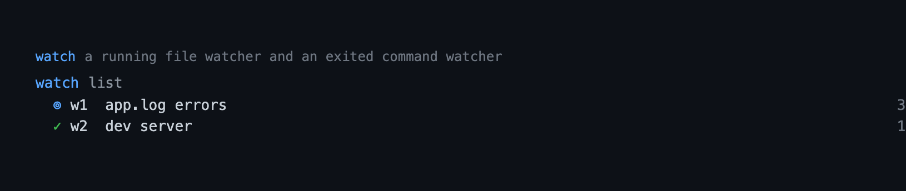

# watch — tail a file or command and alert on pattern matches

Tail a file or a command's merged output, match each new line against a regular
expression, and keep the matching lines. Matches are sanitized and alerted in
the TUI, reported to the model at the next turn, or — when a watcher opts into
`wake` — raise one triggered turn immediately.

```
pi --extension ./extensions/watch    # load just this extension
pi -e .                              # load the whole @gavin-hu/my-pi-agent package
pi install ./                        # install the package
```

## Tool rendering

How the `watch` call and its result look in the transcript — the call line as a headline and the body indented under it:



## What it does

- Registers one model-callable tool, `watch`, with actions `add`, `list`,
  `status`, `matches`, `logs`, `stop`, and `clear`.
- Tails a text file by polling it, or a shell command by streaming its merged
  stdout/stderr. A file is followed from its current end unless `fromStart` is
  set; a shrinking file (rotation/truncation) is re-read from the start.
- Matches with a regular expression and an optional exclude list,
  case-insensitive by default and case-sensitive with `caseSensitive: true`.
- Shows a `⊚ N` running-watcher chip and a `! N` unreported-match chip, raises a
  `ctx.ui.notify` alert once per unreported burst, and offers a `/watch` screen.
- Reports pending matches to the model at the start of the next turn, or wakes a
  turn for a watcher added with `wake: true`.
- Watchers are session-only: `shutdown` flushes a partial line, kills every
  command's process tree, and clears the chips.

## Tool

| Field | Value |
|---|---|
| `name` | `watch` |
| `action` | `add` \| `list` \| `status` \| `matches` \| `logs` \| `stop` \| `clear` |
| `path` | File to tail (`add`); exactly one of `path`/`command`. |
| `command` | Shell command whose output to tail (`add`). |
| `cwd` | Working directory for a command source; defaults to the effective cwd. |
| `pattern` | Regular expression a line must match (`add`, required). |
| `exclude` | Regular expressions that suppress a match (`add`, optional). |
| `caseSensitive` | Match case-sensitively; default `false`. |
| `label` | Short display label (`add`); defaults to the source. |
| `wake` | Wake the agent with one triggered turn on a match (`add`). |
| `fromStart` | Scan a file's existing content instead of tailing from the end (`add`). |
| `id` | Watcher id such as `w1` (`status`/`matches`/`logs`/`stop`). |
| `lines` | Lines to return (`matches`/`logs`, 1–2000). |
| `all` | With `clear`, also stop and remove running watchers. |

Example: watch a log for errors and wake on a match.

```
watch add  { "path": "server.log", "pattern": "ERROR|FATAL", "label": "server", "wake": true }   → w1
watch list
watch matches { "id": "w1", "lines": 50 }
watch logs    { "id": "w1" }
watch stop    { "id": "w1" }
watch clear   { "all": true }
```

Validation is pure and runs before any side effect, so `codemode` callers that
bypass the TypeBox schema cannot start a watcher with a missing source or an
invalid regular expression.

Each result carries a `WatchDetails` object in tool-result `details`:

```
WatchDetails {
  action: WatchAction
  watch?: WatchRecord      // add/status/matches/logs/stop
  watches?: WatchRecord[]  // list/clear
  matches?: string         // sanitized matched lines, newline-joined
  logs?: string            // sanitized raw tail, newline-joined
  truncated?: boolean
  stopped?: boolean        // stop found a running watcher
  cleared?: number
  error?: string
}
```

`WatchRecord` is the serializable watcher state: `id`, `label`, `source`
(`{ kind: "file", path }` or `{ kind: "command", command, cwd }`), `pattern`,
`exclude`, `caseSensitive`, `wake`, `fromStart`, `status`
(`running`/`stopped`/`exited`/`error`), timestamps, `linesRead`, `matchCount`,
and the command's `pid`/`exitCode`/`signal` when applicable.

### Transcript

`add` and `stop` render one outcome line; `list` renders the `/watch` rows
capped at eight rows, minus the selection-marker column (`listRow`'s
`marker: false`) that only the interactive screen needs; `matches` and `logs`
render the tail of the sanitized lines, with the hidden count noted above and
`(ctrl+o to expand)`.

### Command: /watch

A bare `/watch` opens a dock screen listing watchers. `j`/`k` (and the wheel)
move, `Enter`/`l` opens a watcher's matches, `x`/`K` stops a running watcher
behind a `y/N` confirm, `d` clears stopped ones behind a `y/N` confirm, `Esc`
closes, and `g`/`G` and PgUp/PgDn scroll the matches pane. Subcommands work in
every mode:

| Command | Effect |
|---|---|
| `/watch` | Open the screen (TUI) or print the list. |
| `/watch list` | Print the list. |
| `/watch matches <id>` | Print the watcher's matched lines. |
| `/watch logs <id>` | Print the watcher's raw output tail. |
| `/watch stop <id>` | Stop a watcher. |
| `/watch clear [all]` | Remove stopped watchers, or every watcher with `all`. |

## Behaviour by mode

- **tui** — the status chips, the match alert, and the `/watch` dock screen.
  `/watch matches` and `/watch logs` print through a notification.
- **rpc / json / print** — the tool and every `/watch` subcommand work, and the
  status chips and alerts no-op; a bare `/watch` prints the list.

## Configuration

The `watch` section of the shared `bytefly.json` (global then project). Every
value is clamped; a missing or malformed document is ignored.

| Key | Default | Meaning |
|---|---|---|
| `enabled` | `true` | Track watchers at all. |
| `showStatus` | `true` | Show the two status chips. |
| `wakeOnMatch` | `false` | Default for a new watcher's `wake`; a per-watcher `wake` overrides it. |
| `maxWatchers` | `20` | Live watchers before `add` is refused. |
| `maxMatches` | `200` | Matches kept per watcher before the oldest are dropped. |
| `maxLogLines` | `500` | Raw lines kept per watcher for `logs`. |
| `matchLines` | `50` | Lines returned by `matches`/`logs` when `lines` is omitted. |
| `pollMs` | `500` | File poll interval. |

```json
{
  "watch": { "pollMs": 250, "maxMatches": 500 }
}
```

## Security

A command watcher runs a shell command chosen by the model, exactly like `job`
or `bash`; treat a `watch add` with a `command` as arbitrary code execution in
the session. A file watcher only reads a path. File and command output is
untrusted: every line that reaches a widget or the model is stripped of ANSI
escapes and control characters and clipped, so a crafted log cannot restyle or
corrupt the terminal. The session's permission policy can gate the tool like any
other.

## Limitations

- A file watcher polls, so a new line can take up to `pollMs` to surface; it does
  not use `fs.watch`.
- A watcher holds live state in memory and is stopped on shutdown; a detached or
  resumed session starts with no watchers.
- `matches` and `logs` keep bounded histories (`maxMatches`/`maxLogLines`), so
  older lines are dropped.
- Matching is per line; a pattern cannot span a newline.

## Non-goals

- Persisting or reattaching watchers across sessions.
- Notifying through bytefly's OS-notification capability (the `job` extension
  owns that channel; `watch` alerts in-session with `ctx.ui.notify`).
- Multiline or stateful matching, log rotation hooks, and per-watcher poll
  intervals.

## Pi integration

| Point | Contract |
|---|---|
| Tool | One tool, `watch`; `exposure` default (`direct`), active on registration. |
| Execution mode | `sequential` — it mutates the session-scoped watcher table and UI. |
| Annotations | `readOnlyHint: false`, `destructiveHint: true`, `idempotentHint: false`, `openWorldHint: true`. |
| `outputSchema` | None; the result carries `details` only (no `structuredContent` mirror). |
| State storage | In-memory runtime closure; no registry, no `getBranch()` rebuild. |
| Injected context | A shared transcript notice (`my-pi-agent/notice`), rendered by bytefly; pending matches are read from the runtime, never from the transcript. |
| Lifecycle | `session_start` loads config and re-arms `onMatch`; `session_tree` repaints; `agent_start`/`agent_settled` track busy; `before_agent_start` posts pending matches as a notice; `context` prunes stale notices of its own source; `session_shutdown` kills commands and clears chips. |

`watch` is gated by `PI_DISABLED_EXTENSIONS` like every extension.

## Design notes

The file tailer polls and exposes `tick()` publicly; the interval is a thin
wrapper over `tick()`, so tests drive matching deterministically with no real
timer. A command tailer is event-driven and feeds both output streams through
the same byte-oriented line matcher, which only decodes complete lines so a
UTF-8 sequence split across a read boundary is never mangled. State is
session-only by design: a watcher is a live process or file position, not
transcript state, so it cannot be faithfully rebuilt from a `/tree` fork. Match
delivery mirrors `job` — reported at the next turn, with `wake` triggering one
turn — so a match is never dropped when the wake window is busy.

## Files

| Module | Responsibility |
|---|---|
| `index.ts` | Extension factory: registers the tool and command, wires the lifecycle and the shared notices. |
| `tools.ts` | The `watch` tool definition, execution, and transcript rendering. |
| `schema.ts` | TypeBox parameters and pure `normalizeCall` validation. |
| `types.ts` | `WatchAction`/`WatchStatus`, `WatchRecord`, `WatchDetails`, `PendingMatch`. |
| `runtime.ts` | The session-scoped watcher table, matcher, poll tick, and shutdown. |
| `process.ts` | Injectable spawn and process-tree kill. |
| `format.ts` | Pure sanitization and text formatting. |
| `ui.ts` | Status chips and the match alert, over the shared `lib/tui/status-controller.ts`. |
| `tui.ts` | `WatchResult` transcript block and the `/watch` dock screen, drawn from the `lib/tui/` kit (`titleRule`, `listRow`, `emptyState`, `IdCursor`, `LinePane`). |
| `commands.ts` | The `/watch` command and its completions. |
| `config.ts` | The `watch` config section load and normalization. |

## Testing

Pure-module tests cover `config`, `schema`, `format`, and `tui`; `runtime.test.ts`
drives the tailer with a fake clock and fake children; `tools.test.ts`,
`commands.test.ts`, and `extension.test.ts` exercise the tool, command, and
lifecycle through the shared `createFakePi`/`fakeCtx` doubles. The test harness
is `test/helpers/fixtures/watch.ts`.
