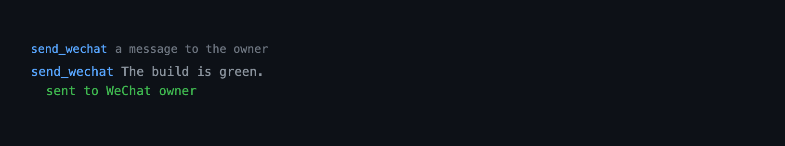

# wechat — a thin WeChat bridge for the live Pi session

Connect the Pi session you are running to WeChat over Tencent's Weixin iLink bot
API. The live session **is** the agent: an inbound WeChat message becomes a user
turn in that session, so Pi answers with its own context and tools, and the
reply is sent back. There is no subprocess and no separate agent.

```
pi --extension ./extensions/wechat   # load just this extension
pi -e .                              # load the whole @gavin-hu/my-pi-agent package
pi install ./                        # install the package
```

## Tool rendering

How the `send_wechat` call and its result look in the transcript — the call line as a headline and the body indented under it:



## What it does

- **Inbound** — a long-poll loop receives WeChat text, images, and files and
  injects them as a real user turn (`pi.sendUserMessage`); the assistant's final
  text is sent back to the sender.
- **Inbound media** — images are downloaded, AES-128-ECB decrypted, and attached
  as model image content; files are saved under `<agent-dir>/wechat/media/` and
  referenced by path. Voice uses the transcript the server provides.
- **Outbound** — replies are delivered automatically; the owner-only
  `send_wechat` tool lets the model message the owner proactively.
- **Typing indicator** — the native typing status is set while an inbound turn is
  being generated (`typingIndicator`, on by default).
- **Remote prompts** — interactive confirmations raised during a WeChat turn
  (`ask_user_question`, plan approval) are sent to WeChat and answered there;
  turns started at the terminal keep the TUI (`remotePrompts`, on by default).
- **Status chip** — the status bar shows `✆ wechat` while the bridge runs and
  keeps an error-colored `✆ wechat expired` after a session expiry
  (`ctx.ui.setStatus`), so the outage stays visible until `/wechat login`
  reconnects or `/wechat logout` stops the bridge; it clears on shutdown.
- **Owner-only by default** — only the account owner (who scanned the login QR)
  can drive the agent; `allowedPeers` opts in others.
- **Session-bound** — the bridge runs while an account is stored and the Pi
  session is alive; it starts on `session_start` and `/wechat logout` clears the
  account and stops it.

## Commands

| Command | Effect |
|---|---|
| `/wechat` | TUI: the control screen. Elsewhere: a one-line summary. |
| `/wechat login` | QR login; on scan, stores credentials and starts the bridge. |
| `/wechat new` | Start a fresh session (also dispatched by an inbound `/new`). |
| `/wechat status` | The same control screen as a bare `/wechat`. |
| `/wechat logout` | Confirm, then clear credentials and stop the bridge. |
| `/wechat help` | List the subcommands. |

The bridge starts automatically on `session_start` (and after `login`) whenever
an account is stored, so there is no start/stop command: the account is the
on/off switch. `/wechat logout` is the only way to stop polling, and it discards
the credentials.

A session that expires while running keeps the `✆ wechat expired` chip:
`/wechat status` reports it and points at the fix, and `/wechat login` is the
one-step recovery.

In the TUI, `/wechat` opens a control screen with the account, connection
state, owner, activity counters, and any pending remote prompt. Keys: `l` log in
or reconnect, `n` start a new session, `o` log out, `r` refresh, and Esc closes.
The subcommands above are shortcuts for the same actions and the only route
outside the TUI; an unknown subcommand reports the valid ones.

## Slash commands

A peer can type a slash command in the chat. The bridge intercepts it before it
becomes a turn, so a command never reaches the model unless it is unknown.

| Command | Kind | Effect |
|---|---|---|
| `/new` | action | Start a fresh session; the bridge reconnects on the new session. |
| `/help` | action | Reply with the available commands. |

- **Snippets** expand a predefined body into the user turn (typing, queueing,
  and reply capture are unchanged); none is registered yet.
- **Actions** run locally and answer on WeChat without starting a turn.
- Matching is exact on the first token and case-insensitive; an unknown `/foo`
  (or a path-like `/usr/...`) falls through to the model as ordinary text, and a
  message carrying media is never treated as a command.
- `/new` is owner-only: an extra `allowedPeers` peer that sends it is refused
  like any other unauthorized sender. `/help` is available to any admitted peer.

## Behaviour by mode

| Mode | Behaviour |
|---|---|
| `tui` | Everything, including the QR login screen and the `/wechat` control screen (`ctx.ui.custom`). |
| `rpc` | The bridge auto-starts and `status` prints the one-line summary; `login` needs the TUI (the QR screen is unavailable over RPC). |
| `json`, `print` | Ephemeral; the bridge does not auto-start and no UI is available. |

## Remote prompts

A dialog raised while a WeChat turn is in flight is forwarded to the sender:

- `select` — a numbered list; reply with a number, the option text, or any other
  text for the free-form “Other” entry.
- `confirm` — reply 是/否 (or yes/no).
- `input` / `editor` — reply with the text.
- Reply 取消 (or cancel) to dismiss.
- Hints are bilingual (Chinese and English). A reply that cannot be read
  re-sends the prompt with a short “didn’t recognize that” notice instead of
  repeating it silently.

The reply is consumed as the answer and never starts a turn of its own; a turn
started at the terminal keeps the normal TUI. Set `remotePrompts: false` to
disable forwarding. See [Design notes](#design-notes) for the mechanism.

## Outbound files

A remote prompt can deliver a local file first. `exit_plan_mode` uses this to
send the plan file itself before the three choices, so WeChat sees the whole plan
(a long one falls back to chunked text if the upload fails). The flow mirrors the
reference client: `getuploadurl` → AES-128-ECB encrypt → `POST` the ciphertext
(`Content-Type: application/octet-stream`) → read `x-encrypted-param` → send a
`type: 4` file item. Only the plan review uses it today; images, video, and voice
are not sent outbound.

## Configuration

The `wechat` section of the shared `bytefly.json`, the global document
overridden by the project `<cwd>/.pi/bytefly.json` (project wins):

```jsonc
// bytefly.json → "wechat"
{
  "allowedPeers": [],        // extra peers; the owner is always allowed
  "maxReplyChars": 4000,     // replies longer than this are split into messages
  "botAgent": "pi-wechat",   // sent as base_info.bot_agent
  "channelVersion": "0.1.0", // sent as base_info.channel_version
  "cdnBaseUrl": "https://novac2c.cdn.weixin.qq.com/c2c", // CDN media base
  "maxMediaBytes": 20971520, // inbound media larger than this is skipped
  "typingIndicator": true,   // show typing while a turn is generated
  "remotePrompts": true      // answer interactive dialogs on WeChat during a WeChat turn
}
```

State lives under `<agent-dir>/wechat/`: `credentials.json` (mode `0600`),
`state.json` (cursor, owner, per-peer reply tokens), `media/` (downloaded inbound
files), and `poller.lock` (stops two sessions polling one account).

## Security

- WeChat text is **untrusted**, and in this design it becomes a turn in your live
  session **with that session's tools** (including `bash`/`write`/`edit`).
  Admission control is the only gate: the default is **owner-only**, and
  `allowedPeers` is an explicit opt-in. A refused sender is counted, not run.
- Inbound text is sanitized (control characters stripped) before it reaches the
  transcript.
- Inbound media is **untrusted**: images become model image content, and files
  are saved under `<agent-dir>/wechat/media/` with sanitized names and a size cap
  (`maxMediaBytes`). Nothing is executed.
- Credentials are written `0600` and redacted from diagnostics; egress is only to
  the Weixin endpoint.
- Automated or unofficial WeChat use can violate WeChat's terms and risk account
  restriction. Single-owner, low-volume use is recommended.

## Limitations

- The bridge shares one conversation with your interactive session. It serializes
  its own messages and only injects when the session is idle, but if you are
  actively typing, a reply may attach to a mixed context.
- Inbound **video** is not handled, and there is no group-chat support. Voice is
  handled only through the server-provided transcript.
- Outbound **files** are supported (used by the plan review); outbound images,
  video, and voice are not, and `send_wechat` sends text only.
- Remote prompts cover the standard dialogs (`select`/`confirm`/`input`/`editor`).
  A third-party extension that renders a full-screen `ctx.ui.custom` component
  cannot be answered over WeChat; a WeChat turn sends it no UI and it should fall
  back to dialogs (see the shared `askHuman` helper).
- A peer can only be replied to after they have messaged first (the protocol
  supplies a `context_token` only then).
- Slash commands are fixed built-ins; there is no user-defined snippet or action
  list yet, and only `/new` and `/help` are registered.
- There is no pause. The bridge runs whenever an account is stored, and
  `/wechat logout` is the only way to stop it (and it discards the credentials).

## Non-goals

Outbound image/video/voice media, video, model-callable sends to arbitrary recipients, per-peer
session isolation, group chats, a local quote cache, and a long-lived RPC child.

## Pi integration

| Integration point | Detail |
|---|---|
| Command | `pi.registerCommand("wechat", …)` — `login`, `new`, `status`, `logout`, `help`; bare `/wechat` opens the control screen. |
| Tools | `send_wechat` — owner-only proactive text; registered at factory time with `exposure: "direct"`, `executionMode: "sequential"`, `openWorldHint: true`. |
| Events | `session_start` (record the live context, re-point the UI adapter, auto-start the bridge when an account exists); `agent_start` / `agent_settled` (busy guard); `message_end` (capture assistant text); `session_shutdown` (idempotent stop, uninstall adapter). |
| Slash commands | Admitted inbound text is matched against `SLASH_COMMANDS` in `handleMessage`; a snippet is expanded into the turn, an action runs out-of-band and replies, and an unknown command falls through. `/new` is an owner-only action wired through `pi.sendUserMessage("/wechat new", { expandPromptTemplates: true })`; `/help` replies with the command list for any admitted peer. |
| Injection | `pi.sendUserMessage(content)` — a string, or text/image blocks for inbound media; always triggers a turn, and the bridge only injects when idle. |
| UI | `installRemoteUI(ctx.ui, channel)` wraps the shared `ctx.ui` dialogs and installs the channel under a string key; `askHuman` in `lib/interaction.ts` routes rich components vs dialogs and delivers a file/text preface. |
| Status | The bridge's connection state (`running` / `expired` / `stopped`) is published through `onStateChange` to `ctx.ui.setStatus(STATUS_KEYS.wechat, …)`; an expiry keeps a persistent error chip, and the status bar renders it on line 2. |
| State | Files under `<agent-dir>/wechat/`; the bridge is not authoritative UI, so nothing is stored in the transcript. |
| Lifecycle | The factory only registers. The poll loop starts on `session_start` when an account is stored (and after `/wechat login`); `session_shutdown` closes it. |

## Design notes

The live session is the agent — an explicit choice over spawning a headless `pi`
per peer. That keeps the agent's real context and tools, at the cost of sharing
the conversation. Because injected messages carry **no correlation id**, the
bridge serializes its turns: it records the peer when it injects, captures the
final assistant text of that run, and flushes the reply on `agent_settled`
before draining the queue. Only the owner may drive it because in-process input
reaches the session's tools.

Media and typing stay at the boundary: downloads go to a fixed CDN with a size
cap, filenames are sanitized before use, and typing is best-effort. The send tool
is owner-only so untrusted generated text cannot be aimed at another account.

Remote prompts reuse Pi's only in-process UI seam: there is no extension-facing
way to replace `ctx.ui`, so `remote-ui.ts` wraps the **shared** `ctx.ui` object
(`runner.uiContext`) and delegates to the saved originals when no WeChat turn is
in flight. The contract lives in `lib/interaction.ts`; `ask_user_question` and
plan mode call `askHuman`, which prefers a rich component only for a local TUI
turn. This depends on an unstated host detail, so it fails closed (prompts simply
stay local) rather than corrupting state; a future Pi UI-delegate API replaces
`remote-ui.ts` alone.

Outbound files use the CDN upload flow (`getuploadurl`, AES-128-ECB ciphertext,
`x-encrypted-param`) and reuse the same AES-128-ECB and key decoders as inbound
media; a failed upload returns false so `askHuman` can fall back to text rather
than blocking the dialog.

The lifecycle is derived from the stored account rather than an explicit
start/stop command: `session_start` opens the bridge while credentials exist and
`session_shutdown` closes it. That is also what lets an inbound `/new` reconnect:
starting a new session tears down and reloads extensions, so the new session's
`session_start` reopens the bridge. `/new` reaches `newSession` through a
registered extension command (`/wechat new`) dispatched with
`expandPromptTemplates`, the only host-sanctioned way for a poll callback to get
a command context.

The operator surface is one verb table: a bare `/wechat` (or `/wechat status`)
opens the control screen, whose keys return the same verbs the subcommands
accept, so each action has a single implementation and there is no subcommand to
memorize. The screen closes with an action the command runs afterwards, so the
QR login screen never opens while the control screen still owns input focus. An
unknown subcommand reports the valid verbs instead of silently falling back to
status, which is what the old start/stop guidance used to do.

## Files

| File | Responsibility |
|---|---|
| `index.ts` | Factory: gate, register the command and tool, wire the lifecycle events, build the bridge. |
| `bridge.ts` | The loop: poll, queue, inject, capture, reply, media, typing, connection state, abort. |
| `commands.ts` | `/wechat login|new|status|logout|help`: the verb dispatch, the panel, login, and logout. |
| `tools.ts` | The `send_wechat` tool (owner-only proactive text). |
| `client.ts` | iLink HTTP client (QR, getupdates, sendmessage, file sendmessage, getuploadurl, getconfig, sendtyping, CDN download/upload) with an injected runner. |
| `media.ts` | Media key/encrypt/decrypt, padded size, upload/download URL, MIME sniff, filename sanitize, and save helpers. |
| `outbound.ts` | Upload and send a local file: hash, encrypt, `getUploadUrl`, upload, `sendFileMessage`. |
| `login.ts` | QR login state machine. |
| `qrcode.ts` | QR matrix → Unicode half-block terminal lines. |
| `login-screen.ts` | The `/wechat login` screen (`ctx.ui.custom`), drawn from the `lib/tui/` kit (`titleRule`, `clip`, `isCloseKey`). |
| `status-screen.ts` | The `/wechat` control screen (`ctx.ui.custom`) and the pure one-line/body renderers, drawn from the `lib/tui/` kit (`titleRule`, `keyValueRow`, `paint`). |
| `config.ts` | The `wechat` section of `bytefly.json` loading and normalization. |
| `credentials.ts` | `credentials.json` (`0600`, multi-account). |
| `state.ts` | `state.json` (cursor, owner, per-peer tokens). |
| `lock.ts` | Poller lockfile. |
| `format.ts` | Sanitize, chunk, and label helpers. |
| `interaction.ts` | The WeChat `InteractionChannel`: pending-prompt state machine and reply routing. |
| `prompt.ts` | Pure prompt formatting and reply parsing. |
| `remote-ui.ts` | The host-UI adapter: wraps the shared `ctx.ui` dialogs and installs the remote-turn marker. |
| `slash.ts` | Inbound slash commands: the built-in registry (`/new`, `/help`) and the pure parse/lookup/expand helpers. |
| `types.ts` | Wire and domain types. |

## Testing

`bun test extensions/wechat`. Modules take injected seams (HTTP runner, clock,
sleep, `pi`/context fakes); no test touches the network or a real session.
Inbound media is exercised with a locally encrypted fixture, so decryption is
tested without a CDN.
